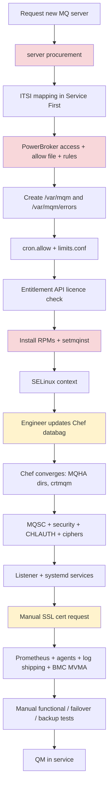
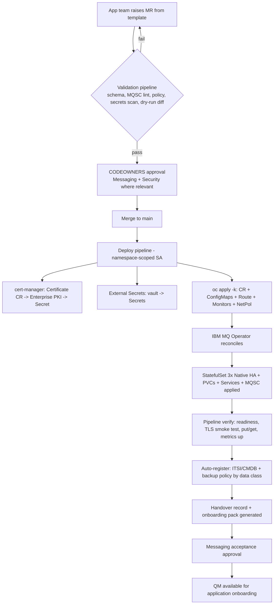
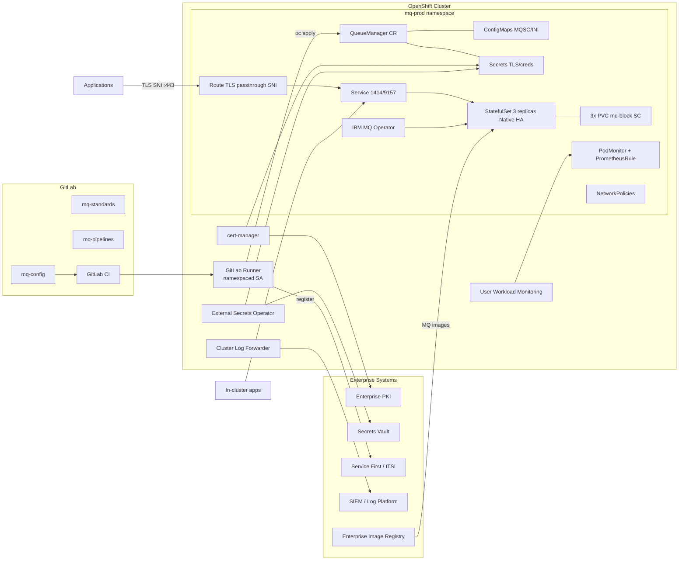
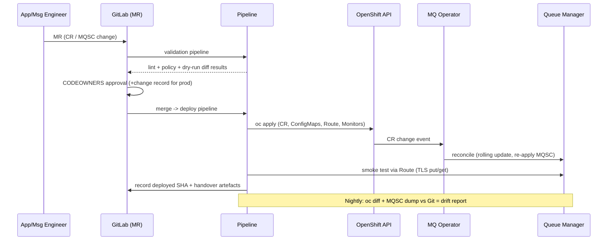
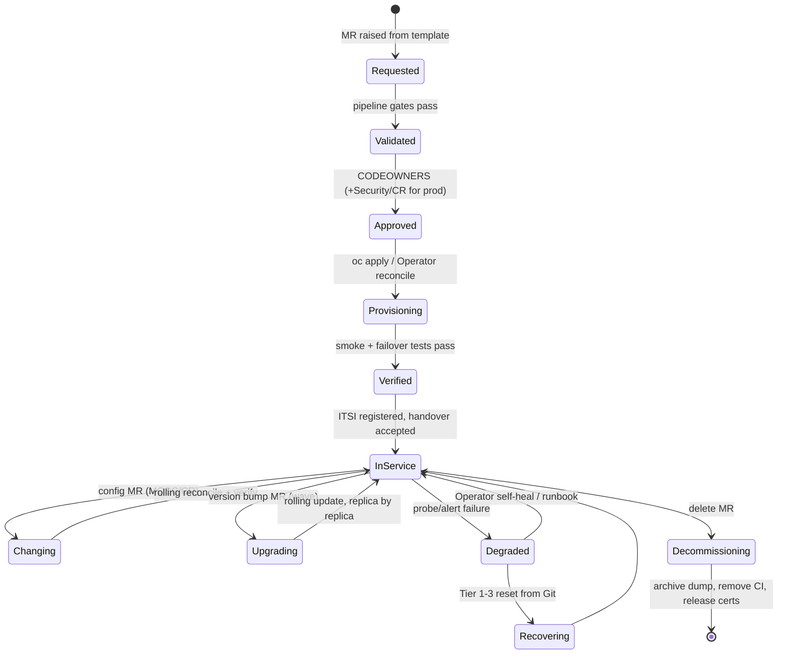
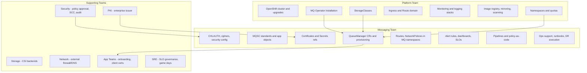

# IBM MQ on Red Hat OpenShift — Target Operating Model & Provisioning Design

**Document type:** Engineering Design Document (for design review)
**Audience:** Platform Engineering, Messaging Engineering, Security, SRE, Architecture, Senior Technical Leadership
**Status:** Draft for review
**Scope exclusion:** IBM MQ Operator installation (owned by OpenShift Platform Team)

---

## SECTION 1 — Executive Summary

### The fundamental shift

Moving IBM MQ from Linux servers to OpenShift is not a re-hosting exercise; it is a change in the *unit of management*. Today the unit of management is a **server**: we procure it, secure access to it, prepare its filesystems, install software onto it, and then hand-craft queue managers on top of it with Chef, shell scripts and manual engineering. The queue manager is a by-product of a long chain of imperative server preparation steps.

On OpenShift, the unit of management becomes a **declarative Custom Resource (CR)**. A queue manager is no longer *built*; it is *declared*. The Messaging Team commits a `QueueManager` CR, MQSC/INI ConfigMaps, and certificate references to Git; a pipeline validates and applies them; and the **IBM MQ Operator** reconciles the declared state into running pods, storage, services and endpoints — continuously, not just at provisioning time. If reality drifts from the declaration, the Operator (and Git) drive it back.

### What this eliminates

Approximately **two-thirds of the current provisioning runbook ceases to exist** as Messaging Team work:

- **Server procurement, OS access control (PowerBroker), filesystem creation, ulimits, cron, SELinux, RPM installation, `setmqinst`** — these are properties of a mutable server. Containers are immutable, pre-built images; the OS layer is the Platform Team's product, consumed via namespaces and quotas.
- **Chef and databags** — replaced by Git as the single source of truth and the Operator as the convergence engine. Chef converges servers on a schedule; the Operator reconciles Kubernetes objects continuously.
- **systemd, listeners, manual start/stop** — replaced by the Operator's lifecycle management, container entrypoints, and liveness/readiness probes.

### What changes character

- **Provisioning** becomes a merge request, not a work order. Lead time drops from days/weeks (server procurement) to minutes (pipeline run), gated by approvals rather than by procurement.
- **Configuration** becomes versioned, peer-reviewed, and reproducible. "Configuration reset" becomes "redeploy from Git", not archaeology across Chef, shell scripts, and engineer memory.
- **High availability** shifts from OS clustering / multi-instance filesystem locking to **Native HA** (Raft-replicated recovery logs across three pods and three PVs), scheduled across availability zones by Kubernetes.
- **Security** shifts from host hardening to Kubernetes RBAC, Secrets, Security Context Constraints, NetworkPolicies and TLS-passthrough Routes with SNI.
- **Operations** shift from "log on and fix" to "observe, and remediate through Git". Interactive `runmqsc` against production becomes a break-glass exception, not a working pattern — otherwise Git and reality diverge and the GitOps model collapses.

### What the Messaging Team keeps

The Messaging Team's value moves *up the stack*: MQ topology design, MQSC standards, CHLAUTH and cipher policy, certificate lifecycle, capacity and performance engineering, application onboarding, and operational support. The team stops being server administrators and becomes **product owners of a messaging-as-a-service capability** delivered through Git.

### Key decisions this document asks leadership to ratify

1. **Git is the single source of truth** for all MQ configuration; interactive administrative change in production is break-glass only.
2. **Native HA** is the default HA model for new queue managers (with storage class implications for the Platform Team).
3. **Namespace ownership**: Messaging Team owns MQ namespaces; Platform Team owns the cluster (Section 10).
4. **GitLab CI is the orchestration engine.** Note: "OpenShift Pipelines" *is* Tekton — the stated constraint ("Tekton not available, use OpenShift Pipelines") is contradictory and must be resolved. This design assumes **GitLab CI with a GitLab Runner on OpenShift** as the primary engine, with OpenShift Pipelines used only if the Platform Team formally offers it as a service (Section 3).
5. **BMC MVMA and agent-based tooling** (Machine ID agent, host log shipping) are challenged and largely retired in favour of platform-native observability (Section 2, Section 11).

---

## SECTION 2 — Comprehensive Mapping: Current Linux Steps → OpenShift Future State

Legend for "Disposition": **ELIMINATED / REPLACED / AUTOMATED / PLATFORM-OWNED / TRANSFORMED / RETAINED**

### 2.1 Server / OS installation steps

| # | Current Step | Purpose Today | OpenShift Equivalent | Disappears? Why? | Recommended Future State & Automation | Owner | Dependencies / Risks / Notes |
|---|---|---|---|---|---|---|---|
| 1 | New server procurement via existing process | Obtain compute for MQ | **None — no servers are procured per queue manager.** Capacity is consumed from the shared cluster via namespace ResourceQuotas | **ELIMINATED.** The server as a unit of provisioning does not exist. Compute is a pooled platform commodity | QM CR declares CPU/memory requests & limits; Platform Team manages aggregate cluster capacity. Messaging Team forecasts demand into quota requests | Platform (capacity), Messaging (per-QM sizing) | **Risk:** capacity management becomes invisible if no quota/forecasting process exists — see Section 11. Bare Metal may still be needed once, at cluster build time (out of scope) |
| 2 | Map service ITSI in Service First | Register service for incident routing & monitoring context | Still required — but per *queue manager / namespace*, not per server | **TRANSFORMED.** ITSI mapping survives but its subject changes from host to logical service | Pipeline stage calls Service First API to register/update the QM's CI record automatically at provision time, using labels/annotations on the CR as metadata source | Messaging (data), Automation (pipeline) | Dependency: Service First API availability. Risk: CMDB drift if registration is manual — automate it. Decide the CI model: QM as CI, namespace as CI, or both (recommend both, QM child of namespace) |
| 3 | PowerBroker Linux server access | Privileged access management on servers | **Kubernetes RBAC** + OpenShift OAuth/IdP groups; `oc` access scoped to namespaces; audit via API server audit logs | **ELIMINATED as a concept.** There is no host login. Pods should not be `exec`'d into except break-glass | RBAC roles: `mq-viewer` (default for engineers), `mq-operator-admin` (change via pipeline SA only), break-glass `exec` role granted just-in-time via PAM/ticket integration | Platform (RBAC framework), Messaging (role bindings in own namespaces), Security (policy) | **Challenge:** do not recreate "everyone can exec into pods". If engineers exec + `runmqsc` routinely, GitOps dies. Risk: cultural resistance |
| 4 | Update allow file | Control which users may access the host | RBAC RoleBindings | **ELIMINATED** — same rationale as #3 | Group-based RoleBindings managed as YAML in Git, applied by pipeline | Messaging + Security | Access lists become reviewable code — an improvement over opaque host files |
| 5 | Create PowerBroker rule | Define permitted privileged commands | RBAC verbs/resources; SCC constrains what containers may do | **ELIMINATED** | None needed beyond RBAC design | Platform / Security | MQ Operator runs under the restricted SCC — no custom privilege engineering required |
| 6 | Create `/var/mqm` | MQ data directory on host | **PersistentVolumeClaim(s)**, declared in the QueueManager CR, provisioned dynamically from a StorageClass | **REPLACED.** Filesystems are not hand-created; storage is requested declaratively and the CSI driver provisions it | CR `spec.queueManager.storage` requests sized volumes. Native HA: 3 × RWO block volumes. Multi-instance (if ever used): RWX file storage | Messaging (request), Platform/Storage (StorageClass, CSI) | Risk: wrong StorageClass performance profile for MQ logs (latency-sensitive). Require a documented, benchmarked "mq-block" StorageClass |
| 7 | Create `/var/mqm/errors` filesystem | Isolate error logs from data | Container ephemeral/log storage; QM error logs go to container stdout (`mirrorDefaultLogs`) and/or the data PV | **ELIMINATED as a separate filesystem.** Log isolation is achieved by shipping logs off the pod, not by partitioning disks | Enable log mirroring to stdout; cluster logging stack ships to enterprise log platform. Optionally separate PVC for `/var/mqm` vs persisted logs per CR spec | Messaging (CR), Platform (cluster logging) | The *reason* for the old step (a full error filesystem shouldn't kill the QM) is solved differently: logs leave the pod |
| 8 | Update `cron.allow` | Permit scheduled host jobs (housekeeping, scripts) | **Kubernetes CronJobs** (if any scheduled MQ tasks remain) — but first challenge whether each job is still needed | **ELIMINATED.** cron is a host concept. Most MQ cron jobs (log cleanup, FDC purge, restarts) are obsolete: the Operator restarts pods, probes detect hangs, storage monitoring alerts on fill | Inventory every current cron job → classify: obsolete / replaced by probe-or-operator / genuinely needed → only the last become CronJobs in Git | Messaging | Risk: silently losing a genuinely needed job (e.g., cert expiry checks — replaced by cert-manager/pipeline). Do the inventory explicitly |
| 9 | Update `/etc/security/limits.conf` | Raise ulimits (files, processes) for MQ | **None for Messaging Team.** IBM's certified container image and the platform node configuration handle kernel/user limits | **ELIMINATED.** Tuning lives in the certified image + node tuning (Platform). Pod-level `resources` replace per-user limits | Set CPU/memory requests/limits in the CR; trust the certified image for the rest | Platform (nodes), IBM (image) | Do not attempt to re-tune inside containers — unsupported and unnecessary |
| 10 | Call internal Entitlement Server API to validate MQ licence | Prove licence entitlement before install | **Declarative licence acceptance in the CR** (`spec.license.accept: true`, licence ID, `use: Production/NonProduction`) + **IBM License Service** on cluster for consumption tracking | **REPLACED.** Entitlement is asserted per-CR and *measured* cluster-wide by IBM License Service (mandatory for container licensing compliance) | Pipeline policy check validates the licence block is correct for the target environment (e.g., NonProduction licence cannot deploy to prod namespace). Periodic export of License Service reports for audit | Messaging (CR), Platform (License Service install), Compliance (reporting) | **Gap:** if the internal Entitlement Server must remain the corporate system of record, add a pipeline call to it — but the authoritative technical mechanism is the CR + License Service |
| 11 | Install RPM packages | Install MQ binaries | **Certified IBM MQ container image**, pulled from IBM Container Registry (mirrored into the enterprise registry), referenced by the Operator per CR version | **ELIMINATED.** Software installation is an image pull. Version = image tag/CR `spec.version` | Enterprise registry mirrors + scans IBM images; CR pins the MQ version; upgrades = CR change in Git | Platform (registry/mirroring), Messaging (version selection) | Risk: pulling directly from internet registries in prod — mandate the internal mirror. Image scanning becomes a new control (Section 11) |
| 12 | Run `setmqinst` | Register installation, set primary installation | **None.** Single-installation container images make installation registration meaningless | **ELIMINATED** — an artefact of multi-install Linux servers | — | — | Nothing replaces it; the concept has no container analogue |
| 13 | Configure SELinux context | Allow MQ processes/filesystems under SELinux | **Security Context Constraints (SCC)** — platform-managed; the MQ Operator is certified to run under `restricted` SCC | **ELIMINATED for Messaging Team.** Node-level SELinux is Platform-owned and invisible; pod security is expressed via SCC/PodSecurity standards | No action; verify the operator's pods run under restricted SCC as part of platform acceptance | Platform / Security | Never request a privileged SCC for MQ — if anything appears to need it, the design is wrong |

### 2.2 Queue Manager configuration steps

| # | Current Step | Purpose Today | OpenShift Equivalent | Disappears? Why? | Recommended Future State & Automation | Owner | Dependencies / Risks / Notes |
|---|---|---|---|---|---|---|---|
| 14 | Engineer updates Chef databag | Declare desired QM attributes | **Git commit** of QueueManager CR + ConfigMaps in the config repo, via merge request | **REPLACED.** Git *is* the databag — but versioned, reviewed, diffable, and enforced continuously by the Operator instead of on Chef's schedule | Self-service: application team raises MR from a template; CODEOWNERS routes approval to Messaging Team; pipeline does the rest | Messaging (approval), App teams (request) | Chef is retired for MQ entirely. Risk: partial migration where Chef and Git both claim truth — set a hard cutover per QM |
| 15 | Chef discovers new queue managers | Convergence trigger | **Operator reconciliation loop** — watches CRs continuously | **REPLACED.** Discovery/convergence is the Operator's core function, event-driven not scheduled | None needed | IBM MQ Operator | This is the heart of the architectural shift |
| 16 | Create `/MQHA/<QMGR>/data` and `/MQHA/<QMGR>/log` | Shared HA filesystems for multi-instance QMs | **Native HA**: three replicated PVs (RWO block), Raft log replication — no shared filesystem | **REPLACED — and improved.** Multi-instance + NFS was a workaround for lacking replication; Native HA replicates at the MQ level with quorum | Default `availability.type: NativeHA` in the CR template. Multi-instance retained only where a documented constraint forces RWX storage | Messaging (CR), Storage (block SC across 3 AZs) | **Decision required:** ratify Native HA as default. Dependency: 3 zones / topology spread. Risk: teams defaulting to SingleInstance in prod — block via policy check |
| 17 | Create queue manager (`crtmqm`) | Instantiate the QM | Operator creates the QM from the CR | **AUTOMATED into the Operator** | — | Operator | — |
| 18 | Run standard MQSC | Apply org-standard objects/settings | **MQSC in ConfigMaps** referenced by the CR (`spec.queueManager.mqsc`), applied by the Operator at start/restart | **TRANSFORMED.** MQSC survives as *content*; its *delivery* becomes declarative. Split into: `00-org-standards.mqsc` (centrally versioned), `10-security.mqsc`, `50-app-objects.mqsc` | Standards MQSC maintained once in a shared repo, pulled into every QM by pipeline; app object MQSC per-QM in Git. Pipeline lints MQSC (syntax, banned commands) pre-merge | Messaging | **Caveat:** Operator applies MQSC at container start — it is not continuously reconciled and is not idempotent by nature. Write MQSC defensively (`DEFINE ... REPLACE`), and treat restarts as re-application events. Deleting an object requires explicit `DELETE` in MQSC or accepting manual drift handling |
| 19 | Apply security standards | Harden QM (auth, connauth, etc.) | Same MQSC/qm.ini mechanism via ConfigMaps + CR | **TRANSFORMED** — becomes versioned policy-as-code | Security-standards MQSC owned by Messaging, reviewed by Security, imported by every QM; pipeline policy gate fails builds missing it | Messaging + Security | Improvement: provable, auditable security baseline per QM per commit |
| 20 | Configure CHLAUTH | Channel authentication rules | CHLAUTH MQSC in ConfigMaps | **TRANSFORMED** (as #19). Note: with TLS-passthrough Routes, client IPs seen by the QM are router/pod-network IPs — **IP-based CHLAUTH rules largely stop working** | Shift CHLAUTH strategy from IP mapping to **TLS certificate DN mapping** (`SSLPEERMAP`). Document this explicitly for app onboarding | Messaging + Security | **Challenge:** current IP-based rules must be redesigned, not migrated. This is one of the most commonly missed items in MQ container migrations |
| 21 | Configure cipher specs | Enforce TLS ciphers | MQSC (channels) + policy; TLS keys via CR `spec.pki` referencing Secrets | **TRANSFORMED** | Central cipher policy file; pipeline gate rejects non-approved CipherSpecs; prefer `ANY_TLS12_OR_HIGHER` with policy enforced at PKI/cert level, per Security's stance | Messaging + Security | Keep cipher policy in ONE place; today it is smeared across Chef and MQSC |
| 22 | Create listener / start listener | Network endpoint for channels | Operator creates the listener (1414) and a **Service** automatically; external access via **OpenShift Route (TLS passthrough + SNI)** | **ELIMINATED as a task.** Listener lifecycle is Operator-managed | CR `spec.queueManager.route` / explicit Route YAML in Git for external access; internal apps connect via the Service | Operator / Messaging (Route) | See Section 10 for the SNI/Route design — non-trivial and mandatory to standardise |
| 23 | Configure systemd services | Auto-start/restart QM on boot/failure | **Operator + StatefulSet + liveness/readiness/startup probes** | **ELIMINATED.** Kubernetes owns process supervision; probes detect failure; the scheduler replaces failed pods; Native HA fails over in seconds | Tune probe thresholds only if defaults are inadequate | Operator | Do not build "restart scripts" — that instinct belongs to the old world |
| 24 | Request SSL certificate | Obtain QM cert from PKI | **Enterprise PKI integrated via cert-manager** (preferred) issuing into **Kubernetes Secrets**, referenced by CR `spec.pki.keys` | **AUTOMATED.** Certificate issuance *and renewal* become declarative (`Certificate` CR) instead of a ticketed human workflow | If cert-manager has an enterprise-PKI issuer (Venafi/ACME/CA plugin): fully automated issue/renew, pipeline restarts/rolls QM on renewal. If not: pipeline stage calls PKI API and writes the Secret — interim only | Messaging (request), PKI (issuer), Platform (cert-manager) | **Decision required:** cert-manager integration with enterprise PKI. Renewal automation is one of the biggest operational wins available — prioritise it (Section 6, 11) |
| 25 | Configure Prometheus | Scrape MQ metrics | MQ image **exposes Prometheus metrics natively (port 9157)**; onboard via ServiceMonitor/PodMonitor into OpenShift user-workload monitoring | **AUTOMATED / PLATFORM-OWNED plumbing.** No exporter to install | Standard PodMonitor + alert rules (PrometheusRule) templated per QM, deployed by the same pipeline as the QM | Messaging (rules), Platform (monitoring stack) | Enable user-workload monitoring (Platform prerequisite). Ship a standard MQ Grafana dashboard as code |
| 26 | Install Machine ID agent | Host identity for enterprise tooling | **No host to identify.** Workload identity = ServiceAccount; node identity = Platform concern | **ELIMINATED** (for Messaging). If an enterprise control genuinely requires workload identity attestation, solve at platform level | Confirm with Security which control the agent satisfied and map it to a Kubernetes-native control | Platform / Security | Do not attempt to run host agents in MQ pods — sidecar sprawl is an anti-pattern here |
| 27 | Install MQ metrics collection | Custom metrics scripts | Native Prometheus metrics (#25) | **ELIMINATED** — superseded | Retire scripts; validate metric parity (some bespoke metrics may need MQSC-based exporters or `amqsrua`-style collection — inventory first) | Messaging | Risk: a dashboard somewhere depends on a bespoke metric — do a metric parity assessment |
| 28 | Install MQ log shipping | Ship MQ/host logs to log platform | **Cluster logging** (platform log forwarder) ships container stdout; QM mirrors error logs (and optionally audit/JSON logs) to stdout | **PLATFORM-OWNED.** Per-server shipping agents disappear | Enable `logs.json` / mirroring in CR; Platform forwards namespace logs to the enterprise SIEM/log store with correct routing & retention labels | Platform (forwarder), Messaging (log format config) | Verify SIEM parsing of MQ JSON logs; update any log-based alerts |
| 29 | Configure BMC MVMA | Legacy MQ monitoring/management | **Challenged: likely retire for OpenShift estate** | **CHALLENGE / LIKELY ELIMINATED.** Running agent-based legacy tooling inside containers is awkward, licence-costly, and duplicates Prometheus + native tooling | Recommend: Prometheus + Grafana + alerting for health/perf; MQ Console / `dspmq*`+pipeline for admin insight. If BMC is mandated enterprise-wide, run it in agentless mode against QMs via client channels — as an explicit, justified exception | Messaging + Leadership | **Decision required:** organisational, not technical. Carrying MVMA forward reduces the transformation benefit materially |

### 2.3 Testing activities

| # | Current Step | Future State | Disposition | Notes |
|---|---|---|---|---|
| 30 | Functional testing | **Automated pipeline stage**: post-deploy connectivity test (client connect via Route), object verification (`dspmq`, MQSC dump vs Git), put/get smoke test | **AUTOMATED** | Runs on every deploy in every environment — not once at provisioning |
| 31 | Performance testing | Standardised perf harness (e.g., PerfHarness/JMS driver) as a pipeline-invocable job in perf namespace; baseline per StorageClass + QM size profile | **TRANSFORMED** | New variables: storage latency, CPU limits, network overlay. Baseline once per platform change, not per QM |
| 32 | Failover testing | **Chaos-style automated test**: kill active Native HA pod, drain node, kill zone — assert reconnection within SLO | **AUTOMATED** | Far cheaper than Linux failover tests; run per release in pre-prod, periodically in prod (game days) |
| 33 | Message loss testing | Persistent-message integrity test through failover (sequenced messages, verify none lost/duplicated) | **AUTOMATED** | Include in Native HA acceptance and after storage/platform changes |
| 34 | Cyber backup & restore | **Redefined** (Section 10): configuration is rebuilt from Git; message data protected via Native HA + (if mandated) PV snapshot/OADP for the *rare* long-lived-message QMs; cyber-recovery = redeploy from Git into clean cluster + restore certs/secrets from vault | **TRANSFORMED** | **Challenge:** backing up queue *messages* is usually the wrong objective — messages are in-flight data. Ratify a data-classification-driven policy |

---

## SECTION 3 — End-to-End Provisioning Workflow (OpenShift)

> **Constraint resolution required:** the brief states "ArgoCD and Tekton are NOT available. Use GitLab + OpenShift Pipelines instead." **OpenShift Pipelines *is* Red Hat's productisation of Tekton.** This design therefore assumes: **GitLab CI as the orchestrator**, executed by a **GitLab Runner running on OpenShift** with a namespaced ServiceAccount, performing `oc apply` / Ansible steps. If the Platform Team does formally offer OpenShift Pipelines, the same stages map 1:1 onto Tekton Tasks triggered from GitLab. Either way, **Git remains the source of truth and the pipeline is the only writer to the cluster.**

### Stage 0 — Request (Application Team)
1. App team completes a **Queue Manager request** — a merge request in the `mq-config` GitLab project created from an issue/MR template (or a ServiceNow form that raises the MR via API). Inputs: application ID, environment, QM name (per naming standard), size profile (S/M/L → CPU/mem/storage presets), persistence requirements, channels/queues needed, data classification, ITSI service mapping data.
2. The MR is generated from a **cookiecutter/Ansible template**: it scaffolds `envs/<env>/<qmgr>/` containing the QueueManager CR, MQSC ConfigMap stubs, Route, PodMonitor, PrometheusRule and NetworkPolicy — engineers edit values, never invent structure.

### Stage 1 — Validation (automatic, on MR)
3. GitLab CI **validation pipeline**:
   - YAML schema validation of the CR (`kubeconform` + Operator CRD schema);
   - MQSC lint (syntax, `REPLACE` discipline, banned commands, mandatory security include);
   - **Policy gates**: licence type matches environment; `NativeHA` mandatory for prod; approved StorageClass; approved CipherSpecs; resource limits within namespace quota; naming standard; labels for ITSI/CMDB present;
   - Secret hygiene scan (no credentials/keys committed);
   - `oc diff --server-side --dry-run` against the target cluster for drift/preview.
4. **CODEOWNERS approval**: Messaging Team approves all MRs; Security additionally approves changes touching `*security*.mqsc`, CHLAUTH, ciphers, or Routes. Production requires a change record ID in the MR (pipeline verifies against ITSM API).

### Stage 2 — Deploy (on merge to environment branch/overlay)
5. Pipeline (runner SA scoped to the target namespace):
   - **Certificates**: ensure a `Certificate` CR exists (cert-manager + enterprise PKI issuer) → PKI issues → key/cert lands in a Kubernetes **Secret**. (Interim, if cert-manager–PKI integration is not ready: Ansible task calls the PKI API and creates the Secret.)
   - **Secrets**: app credentials / truststore material synced from the enterprise vault (External Secrets Operator or Ansible vault-lookup) — never from Git.
   - `oc apply -k envs/<env>/<qmgr>` — ConfigMaps (MQSC/INI), QueueManager CR, Route, PodMonitor, PrometheusRule, NetworkPolicy.
6. **IBM MQ Operator reconciles**: creates StatefulSet (3 replicas for Native HA), PVCs from the MQ StorageClass, Services, applies licence, mounts Secrets/ConfigMaps, starts the QM, runs MQSC, establishes Native HA quorum.
7. Pipeline **waits on readiness**: QM CR status `Running`, all replicas ready, Route admitted.

### Stage 3 — Verification (automatic)
8. **Smoke tests** from a test pod / external runner: TLS client connect via the Route (SNI), auth via cert DN, put/get on a test queue, MQSC dump compared to Git-declared objects, Prometheus target up, metrics flowing, alert rules loaded.
9. **Failover test (pre-prod only, on first provision)**: delete active pod; assert quorum failover + client reconnect within SLO; sequenced persistent-message integrity check.

### Stage 4 — Registration & handover (automatic + one human gate)
10. **Service registration**: pipeline calls Service First / ITSI API — create/update QM CI, link to namespace CI and application service, set support group = Messaging Team, attach environment/criticality from CR labels.
11. **Monitoring onboarding**: already done as code (PodMonitor + PrometheusRule deployed with the QM); pipeline verifies alerts route to the right ITSI service.
12. **Backup registration** (only if the QM's data classification requires PV snapshots): pipeline labels PVCs / creates OADP schedule entry.
13. **Operational handover**: pipeline generates a **handover record** (MR link, CR versions, endpoints, cert expiry, dashboards, runbook link) posted to the Messaging Team channel + attached to the CMDB CI. A Messaging engineer performs a single **acceptance approval** in GitLab → QM status "In Service".
14. **Application onboarding pack** auto-generated: Route hostname, channel name, SNI requirements, CipherSpec, truststore chain, sample CCDT JSON.

End state: **Queue Manager available for application onboarding** — typically < 1 hour elapsed, of which human time is two approvals.

---

## SECTION 4 — Git Repository Structure

### 4.1 Repositories (recommend 3 + 1)

| Repo | Content | Why separate |
|---|---|---|
| `mq-standards` | Org-standard MQSC (baseline objects, security, CHLAUTH patterns, cipher policy), qm.ini fragments, CR base templates, policy rules (OPA/conftest), shared pipeline templates | One version of the truth for standards; consumed by all QMs as a versioned dependency (tagged releases) |
| `mq-config` | Per-environment, per-QM desired state: CRs, MQSC overlays, Routes, monitors, NetworkPolicies. **This repo = the estate** | The GitOps source of truth; CODEOWNERS-protected |
| `mq-pipelines` | GitLab CI templates, Ansible roles/playbooks (PKI calls, ITSI registration, smoke/failover tests), container images for pipeline jobs | Reused logic versioned independently of config |
| `mq-runbooks` (optional) | Operational runbooks-as-code, game-day scripts | Keeps ops knowledge versioned next to the estate |

### 4.2 `mq-config` layout (Kustomize base/overlay)

```
mq-config/
├── CODEOWNERS
├── .gitlab-ci.yml                  # includes from mq-pipelines
├── base/
│   └── queuemanager/               # generic QM kustomize base
│       ├── kustomization.yaml
│       ├── queuemanager.yaml       # CR skeleton
│       ├── podmonitor.yaml
│       ├── prometheusrule.yaml
│       └── networkpolicy.yaml
├── envs/
│   ├── dev/
│   │   ├── namespace.yaml          # mq-dev (if messaging-managed)
│   │   └── qm-pay01/
│   │       ├── kustomization.yaml  # base + patches + version pins
│   │       ├── qm.yaml             # env-specific CR patch
│   │       ├── mqsc/
│   │       │   ├── 10-security.mqsc     # imported from mq-standards@v2.3
│   │       │   ├── 20-chlauth.mqsc
│   │       │   └── 50-app-objects.mqsc
│   │       ├── ini/qm.ini
│   │       ├── certificate.yaml    # cert-manager Certificate CR
│   │       └── route.yaml
│   ├── qa/  ... (same shape)
│   ├── uat/ ...
│   └── prod/ ...
└── docs/
```

### 4.3 Example — QueueManager CR (prod, Native HA)

```yaml
apiVersion: mq.ibm.com/v1beta1
kind: QueueManager
metadata:
  name: qm-pay01
  namespace: mq-prod
  labels:
    app.kubernetes.io/managed-by: gitlab
    itsi.service: payments-messaging
    dataclass: internal
    env: prod
spec:
  license:
    accept: true
    license: L-XXXX-XXXXXX          # current MQ licence ID
    use: Production
  version: 9.4.2.0-r1               # pinned; upgrades via MR
  queueManager:
    name: QMPAY01
    availability:
      type: NativeHA
    resources:
      requests: { cpu: "1", memory: 2Gi }
      limits:   { cpu: "2", memory: 2Gi }
    storage:
      defaultClass: mq-block-premium
      queueManager: { size: 20Gi }
    mqsc:
      - configMap: { name: qm-pay01-mqsc, items: [10-security.mqsc, 20-chlauth.mqsc, 50-app-objects.mqsc] }
    ini:
      - configMap: { name: qm-pay01-ini, items: [qm.ini] }
  pki:
    keys:
      - name: default
        secret: { secretName: qm-pay01-tls, items: [tls.key, tls.crt] }
    trust:
      - name: enterprise-ca
        secret: { secretName: enterprise-ca-bundle, items: [ca.crt] }
  web:
    enabled: false                  # enable per policy decision
```

### 4.4 Example — MQSC fragment (`10-security.mqsc`, from mq-standards)

```
* Security baseline vX.Y — do not edit locally
ALTER QMGR CHLAUTH(ENABLED) CONNAUTH('SYSTEM.DEFAULT.AUTHINFO.IDPWOS')
ALTER AUTHINFO('SYSTEM.DEFAULT.AUTHINFO.IDPWOS') AUTHTYPE(IDPWOS) ADOPTCTX(YES) CHCKCLNT(REQUIRED)
SET CHLAUTH('*') TYPE(BLOCKUSER) USERLIST('*MQADMIN') ACTION(REPLACE)
SET CHLAUTH('APP.SVRCONN') TYPE(SSLPEERMAP) SSLPEER('CN=*.apps.example.corp') USERSRC(MAP) MCAUSER('appmq') ACTION(REPLACE)
DEFINE CHANNEL('APP.SVRCONN') CHLTYPE(SVRCONN) SSLCAUTH(REQUIRED) SSLCIPH('ANY_TLS12_OR_HIGHER') REPLACE
REFRESH SECURITY TYPE(CONNAUTH)
```

### 4.5 Secrets & certificates in Git

**Never store secret material in Git.** Git holds *references and declarations only*:

```yaml
# certificate.yaml — declaration; private key never touches Git
apiVersion: cert-manager.io/v1
kind: Certificate
metadata: { name: qm-pay01-tls, namespace: mq-prod }
spec:
  secretName: qm-pay01-tls
  duration: 8760h
  renewBefore: 720h
  commonName: qmpay01.mq.example.corp
  dnsNames: [ qmpay01.mq.example.corp ]
  issuerRef: { name: enterprise-pki, kind: ClusterIssuer }
```

If a secret must be represented in Git at all, use **Sealed Secrets or SOPS-encrypted manifests**; preferred pattern is **External Secrets Operator pulling from the enterprise vault**.

### 4.6 Pipeline definition example (excerpt)

```yaml
# .gitlab-ci.yml (mq-config)
include:
  - project: messaging/mq-pipelines
    file: /templates/mq-qm-pipeline.yml

stages: [validate, plan, deploy, verify, register]

validate:mqsc:   { extends: .mqsc-lint }
validate:policy: { extends: .conftest-policies }
plan:diff:       { extends: .oc-dry-run-diff }
deploy:apply:
  extends: .oc-apply-kustomize
  environment: $TARGET_ENV
  rules: [{ if: '$CI_COMMIT_BRANCH == "main"' }]
verify:smoke:    { extends: .mq-smoke-test }
register:itsi:   { extends: .servicefirst-register }
```

### 4.7 Environment separation, branching, versioning

- **Environment separation by directory overlays (`envs/dev|qa|uat|prod`), not by long-lived environment branches.** Environment branches invite drift and painful merges; directories keep one auditable history.
- **Branching:** trunk-based. Short-lived feature branches → MR → `main`. `main` is the deployed truth for *all* environments; promotion = an MR that copies/uprevs the overlay (e.g., bump `version:` or MQSC tag in `envs/uat` after QA passes). Prod deploys additionally require a manual pipeline gate + change record.
- **Versioning:**
  - `mq-standards` released as **semver tags** (`v2.3.0`); each QM pins the tag it consumes — upgrades are explicit MRs.
  - MQ product version pinned in each CR; never `latest`.
  - Every deploy pipeline records commit SHA → cluster (annotation on the CR: `gitlab.com/commit`), making "what is running?" answerable from Git.

---

## SECTION 5 — Where Configuration Belongs

| Location | Belongs there | Why |
|---|---|---|
| **Git** | QueueManager CRs; MQSC; qm.ini; Routes; NetworkPolicies; monitors & alert rules; Certificate *declarations*; pipeline code; policy rules; RBAC RoleBindings for MQ namespaces; documentation | Anything that defines desired state and benefits from review, versioning, diff and reproducibility. Git is the audit trail and the recovery mechanism |
| **Kubernetes Secrets** | TLS private keys & certs; keystore/truststore material; app/LDAP credentials; API tokens used by pipelines | Sensitive at rest; consumed by pods via the CR (`spec.pki`) or env/volume mounts. Populated by cert-manager / External Secrets from vault — **never authored in Git** |
| **ConfigMaps** | MQSC files; qm.ini; CCDT JSON for clients; non-sensitive tuning | Non-sensitive config the Operator mounts into the container; the delivery vehicle for Git-managed MQ config |
| **IBM MQ CR** | Identity (name), version, licence, HA type, sizing (CPU/mem/storage), references to ConfigMaps/Secrets, Route/web toggles, probes/tolerations overrides | The CR is the *contract with the Operator* — topology and lifecycle, not fine-grained MQ objects. Keep MQ object detail in MQSC ConfigMaps so the CR stays stable |
| **OpenShift (platform-level)** | StorageClasses; Ingress controllers; SCCs; cluster monitoring & logging stacks; image registry/mirroring; Operator subscription & channel; cluster RBAC; nodes/zones | Shared substrate — one consistent implementation for all tenants; owned and lifecycled by the Platform Team, consumed by Messaging via contracts (SC name, Route domain, monitoring endpoints) |
| **Enterprise systems** | PKI/CA (issuance root of trust); secrets vault (system of record for credentials); Service First/ITSI (service model, incident routing); SIEM/log platform (retention, audit); ITSM (change records); licence/entitlement records; backup platform (OADP target) | Systems of record that outlive any one cluster. The pipeline *integrates* with them; it does not replace them. Keeping them enterprise-side preserves audit and cross-platform consistency |

**Principle:** *declarations in Git, secrets in vault/Secrets, shared substrate in OpenShift, records of truth in enterprise systems — and the pipeline is the only thing that moves data between them.*

---

## SECTION 6 — Automation Opportunities

| # | Opportunity | Mechanism | Trigger | Value / Notes |
|---|---|---|---|---|
| 1 | **Queue Manager provisioning** | Template-scaffolded MR → validation pipeline → `oc apply` → Operator | MR merge | Days → minutes; zero manual cluster interaction |
| 2 | **MQSC deployment** | MQSC in ConfigMaps; pipeline lints, diffs, applies; Operator (re)applies on restart. For zero-restart object changes: pipeline job runs MQSC via a short-lived admin Job against the QM, *then* commits the same MQSC to Git (Git-first rule) | MR merge | Ends "MQSC by hand"; every object change is reviewed |
| 3 | **Certificate renewal** | cert-manager + enterprise PKI ClusterIssuer; `renewBefore` drives auto-renewal; controller/pipeline performs rolling restart of QM pods on Secret change; expiry alerts from cert-manager metrics | Time-based | Eliminates the #1 cause of MQ outages (expired certs) |
| 4 | **Monitoring onboarding** | PodMonitor + PrometheusRule + Grafana dashboard deployed as part of the QM kustomization | Provisioning | Monitoring can never be "forgotten" — it ships with the QM |
| 5 | **Service (ITSI/CMDB) registration** | Pipeline stage calls Service First API using CR labels as payload; de-registration on decommission pipeline | Provision / decommission | CMDB accuracy becomes a side-effect of deployment |
| 6 | **Backup registration** | Data-classification label on CR → pipeline conditionally creates OADP/Velero schedule or PVC snapshot policy | Provisioning | Backup policy enforced by code, not memory |
| 7 | **Pipeline validation (shift-left)** | kubeconform vs CRD schema; MQSC linter; secret scanning; naming/label checks | Every MR | Bad config never reaches a cluster |
| 8 | **Policy validation** | OPA/Conftest rules: NativeHA-in-prod, licence-vs-env, approved StorageClass/CipherSpecs, resource ceilings, mandatory security MQSC include, no privileged SCC | Every MR + scheduled audit against live cluster | Turns standards documents into enforced controls |
| 9 | **Health checks** | Operator-managed liveness/readiness/startup probes; synthetic put/get canary CronJob per environment; Route/TLS handshake probe | Continuous | Detects hang states probes miss; feeds SLOs |
| 10 | **Drift detection (no ArgoCD)** | Scheduled pipeline: `oc diff` cluster vs Git per QM + `DISPLAY`-based MQSC dump vs Git MQSC; report to Messaging channel; optional auto-remediate flag | Nightly | The compensating control for not having ArgoCD — treat as mandatory |
| 11 | **Failover & message-integrity testing** | Chaos job kills active Native HA pod / drains node; sequenced persistent-message verifier | Per release (pre-prod), scheduled game days | HA that is never tested is HA that doesn't exist |
| 12 | **Upgrades** | MQ version bump = one-line CR change; pipeline waves: dev → qa → uat → prod with soak gates; Operator performs rolling update (Native HA: replica-by-replica, no outage) | MR | Estate-wide MQ upgrade becomes a controlled Git campaign |
| 13 | **Decommissioning** | "Delete" MR removes the QM directory → pipeline archives final MQSC dump + metrics snapshot, drains queues check, deletes CR (Operator tears down), removes CMDB/monitoring entries, releases certs | MR | Prevents the orphaned-QM problem endemic on Linux estates |
| 14 | **Capacity & licence reporting** | Scheduled job: namespace quota utilisation, per-QM resource usage, IBM License Service export → dashboard + monthly report | Scheduled | Feeds Platform capacity planning and compliance |
| 15 | **Secret rotation** | External Secrets Operator syncs vault rotations; pipeline rolls pods on Secret version change | Vault event / schedule | Closes a gap that mostly doesn't exist on Linux today |

---

## SECTION 7 — RACI Matrix

R = Responsible, A = Accountable, C = Consulted, I = Informed

| Activity | Messaging | Platform | Storage | Network | Security | PKI | App Team | SRE |
|---|---|---|---|---|---|---|---|---|
| OpenShift cluster build & lifecycle | I | **A/R** | C | C | C | – | – | C |
| IBM MQ Operator install/upgrade (channel/approval) | C | **A/R** | – | – | C | – | – | I |
| StorageClasses for MQ (perf profile, zones) | C | **A** | **R** | – | – | – | – | I |
| Ingress controllers / Route domain | I | **A/R** | – | C | C | – | – | I |
| MQ namespace creation & quotas | C | **A/R** | – | – | C | – | – | I |
| RBAC within MQ namespaces | **A/R** | C | – | – | C | – | – | I |
| Queue Manager CR & provisioning | **A/R** | I | – | – | C | – | C | I |
| MQSC / MQ configuration standards | **A/R** | – | – | – | C | – | I | I |
| CHLAUTH / channel security design | **A/R** | – | – | – | **C**(approve) | – | C | I |
| TLS certificates (request/renew via cert-manager) | **A/R** | C | – | – | C | **R**(issuer) | I | I |
| Enterprise PKI issuer / CA chain | C | C | – | – | C | **A/R** | – | – |
| Secrets vault integration (ESO) | R | **A** | – | – | C | – | – | I |
| NetworkPolicies for MQ namespaces | **A/R** | C | – | C | C | – | I | I |
| Firewall / external connectivity to Routes | I | C | – | **A/R** | C | – | C | I |
| Monitoring stack (Prometheus, user workload) | C | **A/R** | – | – | – | – | – | C |
| MQ alert rules, dashboards, SLOs | **A/R** | I | – | – | – | – | C | **C/R**(SLOs) |
| Pipeline templates & runners | **A/R** | C(runner infra) | – | – | C | – | – | I |
| Policy-as-code rules | **A/R** | C | – | – | **C**(approve) | – | – | I |
| Image mirroring & scanning of MQ images | C | **A/R** | – | – | C | – | – | I |
| Application onboarding to a QM | C | – | – | – | C | – | **A/R** | I |
| Client TLS certs / CCDT for apps | C | – | – | – | C | R | **A/R** | I |
| Incident response — QM level | **A/R** | C | C | C | C | – | I | R |
| Incident response — cluster/node level | C | **A/R** | C | C | – | – | – | R |
| Capacity management — namespace/QM | **A/R** | C | C | – | – | – | C | C |
| Capacity management — cluster | C | **A/R** | C | – | – | – | – | C |
| Backup/DR policy for MQ data | **A/R** | C | C | – | C | – | C | C |
| DR execution / game days | **R** | **R** | C | C | I | – | C | **A** |
| Audit & compliance evidence (MQ estate) | **A/R** | C | – | – | C | – | – | I |

**Organisational decisions required:** (a) whether SRE is a separate function or a hat worn by Messaging; (b) who owns the GitLab runner infrastructure; (c) Security's approval role in CODEOWNERS must be formally accepted by Security.

---

## SECTION 8 — Linux Concepts That Disappear

| Linux concept | Why it disappears | What replaces it |
|---|---|---|
| **Server procurement** | No per-workload servers; compute is a pooled cluster commodity | Namespace + ResourceQuota; CR resource requests; Platform capacity management |
| **Filesystem creation (`/var/mqm`, `/MQHA/...`)** | Containers have immutable images + declared volumes; nobody runs `mkfs`/`mkdir` on a host | PVCs dynamically provisioned from StorageClasses; Operator mounts them |
| **RPM installation** | Software arrives as a certified, scanned container image; installation is an image pull | IBM MQ container image, version pinned in the CR, mirrored in the enterprise registry |
| **`setmqinst`** | No multi-installation host; one image = one installation | Nothing — the concept is void |
| **systemd** | Kubernetes owns process supervision, restart, ordering | Operator + StatefulSet + liveness/readiness/startup probes + Native HA failover |
| **cron / cron.allow** | No host scheduler; most jobs existed to compensate for missing supervision/observability | Kubernetes CronJobs (for the few surviving jobs), probes, alerts, cert-manager |
| **`/etc/security/limits.conf` (ulimits)** | Tuning is baked into the certified image and node config | Pod `resources` requests/limits; Platform node tuning; IBM image defaults |
| **SELinux context configuration** | Node SELinux is platform-invisible; workload confinement is expressed at pod level | Security Context Constraints / Pod Security admission (restricted); certified image compatibility |
| **PowerBroker (host PAM)** | There is no host login and there should be no routine pod login | Kubernetes RBAC + IdP groups; API-server audit logs; break-glass `exec` role with JIT approval |
| **allow files / OS users for engineers** | Access is to the API, not the OS | RoleBindings in Git; SSO via OpenShift OAuth |
| **Chef + databags** | Scheduled convergence of mutable servers is replaced by continuous reconciliation of declared state | Git (source of truth) + GitLab pipeline (delivery) + IBM MQ Operator (reconciliation) |
| **Shell-script provisioning glue** | Steps either vanish or become pipeline code | Ansible roles / pipeline jobs — versioned, tested, reviewed |
| **Listener creation/start (`runmqlsr`, MQSC listener objects for ops)** | The Operator manages the listener and Service endpoints | Operator-managed listener + Kubernetes Service + OpenShift Route |
| **Host monitoring/log agents (Machine ID, log shipping, MVMA agents)** | No host; per-node agents are platform infrastructure | Native Prometheus metrics (9157), cluster logging forwarder, platform node agents |
| **Manual SSL keystore admin on host (`runmqckm`/gsk)** | Key material lives in Secrets; the Operator wires it into the QM keystore | cert-manager + Secrets + CR `spec.pki` |
| **Entitlement server pre-install check** | Licensing is declared per CR and metered in-cluster | `spec.license` + IBM License Service reporting |

---

## SECTION 9 — New OpenShift Concepts That Become Mandatory

| Concept | Why mandatory for MQ | Key design points |
|---|---|---|
| **Namespaces** | Tenancy, RBAC, quota and NetworkPolicy boundary for the MQ estate | One namespace per environment (`mq-dev/qa/uat/prod`) minimum; consider per-domain split in prod (Section 10) |
| **PersistentVolumeClaims / StorageClasses** | QM data & recovery logs must survive pod rescheduling; Native HA needs 3 × RWO block volumes across zones | Dedicated, benchmarked `mq-block` StorageClass; `volumeBindingMode: WaitForFirstConsumer`; expansion enabled |
| **Secrets** | TLS keys, credentials — mounted by the Operator | Populated by cert-manager/ESO; etcd encryption at rest (Platform); access restricted via RBAC |
| **ConfigMaps** | Delivery vehicle for MQSC/INI | Changes roll through Git; note Operator applies MQSC at pod start |
| **Routes (TLS passthrough + SNI)** | Only path for external MQ traffic through the OpenShift router | See Section 10 — SNI behaviour changes client requirements |
| **Services** | Stable in-cluster endpoints for app-to-QM traffic | Prefer in-cluster Service over Route for co-located apps (lower latency, no SNI constraints) |
| **ServiceAccounts** | Pipeline identity (only writer to namespaces); QM pod identity | Runner SA per namespace with least privilege; no personal kubeconfigs in CI |
| **RBAC** | Replaces PowerBroker entirely | Roles: viewer (default), break-glass exec, pipeline deployer; all bindings in Git |
| **Security Context Constraints / Pod Security** | Gate on what MQ pods may do; MQ runs `restricted` | Reject any request for elevated SCC for MQ workloads |
| **Operators & Custom Resources** | The QueueManager CR *is* the provisioning interface | Understand CR schema deeply; treat Operator channel upgrades as change-managed events |
| **Liveness / Readiness / Startup probes** | Replace systemd + human "is it up?" checks; drive traffic gating and restarts | Defaults usually fine; tune startup probe for large QMs with long media recovery |
| **Rolling updates** | MQ version/config changes roll pod-by-pod; Native HA keeps service up | Always pair with PodDisruptionBudget awareness and client auto-reconnect |
| **NetworkPolicies** | Default-deny east-west; explicitly allow app→QM (1414), Prometheus→9157, HA replication ports | A *new* control with no Linux predecessor in this estate — mandatory in regulated environments |
| **ResourceQuotas / LimitRanges** | Protect the shared cluster from a runaway QM and vice versa | Quota per MQ namespace agreed with Platform; every CR must set requests/limits |
| **Topology spread / zone anti-affinity** | Native HA replicas must land in different zones to survive zone loss | Verify Operator defaults; make it a policy check |
| **PodDisruptionBudgets** | Protect quorum during node drains/cluster upgrades | Operator manages for Native HA — verify and document behaviour with Platform's upgrade process |
| **Image registry & pull secrets** | MQ images come from IBM entitled registry via enterprise mirror | Platform owns mirroring + scanning; Messaging pins digests/tags |
| **etcd-backed API as the runtime source of state** | `oc get/describe` replaces `ps`, `df`, log-grepping as first diagnostic | Retrain the team: `oc` fluency is now a core messaging skill |

---

## SECTION 10 — Answers to the Additional Design Questions

### 10.1 TLS Routes
- External clients reach MQ via an **OpenShift Route with TLS *passthrough*** termination. The OpenShift router routes on **SNI**, so **TLS is mandatory** for any traffic entering via a Route — there is no plaintext MQ over Routes. This is a feature: it retires the "should this channel be TLS?" debate for external access.
- **SNI implications (must be socialised with app teams):**
  - Clients must support TLS + SNI (MQ client ≥ 9.x, JMS with current JSSE, .NET managed with SNI enabled).
  - Decide the SNI scheme: **`outboundSNI=HOSTNAME`** with one hostname per queue manager (recommended: `qm-<name>.<env>.mq.apps.<domain>`) is simpler than per-channel SNI hostnames; per-channel routing requires additional Routes per channel with MQ's channel-name SNI encoding.
  - **IP-based CHLAUTH stops being meaningful** (client source IP is the router). Mandate **SSLPEERMAP (certificate DN) based CHLAUTH** as the standard.
- In-cluster applications should connect via the **Kubernetes Service**, not the Route (lower latency, no router hop); TLS still recommended per zero-trust policy.
- Standardise one wildcard or per-QM certificate strategy with PKI; publish a **client onboarding pack** (hostname, port 443, SNI, CipherSpec, CA chain, sample CCDT).

### 10.2 ITSI Mapping
- Keep ITSI/Service First mapping — but re-model: **CI = Queue Manager (logical service)**, parented to the **namespace/platform service**, linked to consuming application services. Host CIs disappear.
- Registration is a **pipeline stage** (Section 3, Stage 4), fed from CR labels (`itsi.service`, `env`, criticality). Decommission pipeline removes/retires the CI.
- Alert routing: PrometheusRule labels carry the ITSI service so alerts land on the right service tree automatically.

### 10.3 Namespace ownership
- **Recommendation:** Platform Team *provisions* namespaces (they own cluster multi-tenancy, quotas, default NetworkPolicies); **Messaging Team owns and administers the contents** — RBAC RoleBindings, workloads, policies within the namespace, all via Git.
- Topology: `mq-dev`, `mq-qa`, `mq-uat`, `mq-prod` as the baseline. In production, consider splitting by domain/criticality (`mq-prod-payments`, `mq-prod-core`) when blast-radius isolation, differing quotas, or separate RBAC audiences justify it. **Do not** create a namespace per queue manager (quota/monitoring/RBAC sprawl) and **do not** put QMs in application namespaces (messaging loses operational control; standards drift).
- Applications never get write access to MQ namespaces; they interact via Git MRs and consume endpoints.

### 10.4 Configuration reset strategy
- **Git is the reset button.** A corrupted or drifted QM configuration is recovered by re-applying the Git-declared state: `oc apply -k` (CR/ConfigMaps) + QM restart re-runs MQSC. For deeper corruption: delete the CR (retain PVCs if messages must survive) and recreate from Git; or full recreate with new PVCs when message loss is acceptable/desired.
- Preconditions that make this true — and must be enforced:
  1. **No interactive `runmqsc` changes in prod** outside break-glass; every break-glass change is back-ported to Git within a defined SLA (e.g., 24h) — the drift-detection job (Section 6 #10) polices this.
  2. MQSC written idempotently (`DEFINE ... REPLACE`, explicit `DELETE` for removals).
  3. Secrets/certs recoverable from vault/PKI, never only in-cluster.
- Document three tiers: **Tier 1** re-apply (config drift), **Tier 2** recreate-keep-data (pod/CR corruption), **Tier 3** recreate-clean (full reset) — each with approval level and expected message impact.

### 10.5 Disaster Recovery
- **In-cluster HA ≠ DR.** Native HA survives pod/node/zone failure inside one cluster. DR = loss of the cluster/region.
- Recommended layered model:
  - **Configuration DR: trivially solved by GitOps** — redeploy the entire estate to a recovery cluster from Git (target: minutes–hours). Rehearse it; this is the headline win.
  - **Message data DR:** classify QMs. Most (request/reply, transient) accept message loss in a regional disaster → config-only DR. For QMs with long-lived business-critical persistent messages: use **storage-level async replication of PVs** to the DR cluster, or MQ-level **Native HA cross-region replication (CRR)** if the installed MQ version supports it — evaluate against RPO requirements. Application-level redelivery remains the most robust answer; push this into onboarding conversations.
  - Secrets/certs: vault and PKI are enterprise systems available at DR site; cert SANs must cover DR Route hostnames (or re-issue as part of DR runbook).
- **Decision required:** per-data-class RPO/RTO matrix ratified by Architecture + app owners.

### 10.6 Persistent vs Non-Persistent messaging — guidance
- Semantics are unchanged from Linux, but the failure model is more visible:
  - **Persistent messages** are Raft-replicated across the three Native HA volumes; they survive pod, node and zone failure. Cost: log I/O — size storage class accordingly.
  - **Non-persistent messages** are lost on any failover/restart — which in Kubernetes happens *more routinely* (rolling updates, node drains) than on a stable Linux server. **Message this clearly to app teams:** if losing it hurts, it must be persistent; if it's persistent, the app must handle redelivery/duplicates (MQ is at-least-once across failover in practice).
  - Encourage `NPMCLASS(HIGH)` awareness but never as a durability substitute.
- Bake the choice into the onboarding template: data class → persistence → storage sizing → DR tier, decided once, recorded in Git.

### 10.7 Backup
- **Reframe:** on Linux, "backup" conflated three things now handled separately:
  1. **Configuration** → Git (plus nightly automated MQSC dump-to-artifact as a belt-and-braces audit snapshot).
  2. **Messages** → generally *not* backed up: point-in-time restore of queues resurrects already-processed messages (duplicates) and loses newer ones — usually worse than the failure. Native HA + persistence + app redelivery is the protection model. Exception: regulatory hold / long-lived store QMs → **PV snapshots via OADP/Velero (CSI snapshots)** with app-consistent scheduling, registered automatically by data-class label (Section 6 #6).
  3. **Secrets/keys** → vault/PKI are the systems of record; nothing QM-local to back up.
- **Cyber recovery:** the clean-room rebuild = fresh cluster + Operator (Platform) + `mq-config` from an immutable Git replica + secrets from vault. Faster and *cleaner* than restoring server images (no risk of restoring the compromise). Add Git repo immutability/offline copy to the cyber-recovery vault.

### 10.8 Platform lifecycle / lifecycle management
- Three loosely coupled lifecycles, each change-managed:
  - **OpenShift cluster** (Platform): EUS-to-EUS or n-1 upgrades; MQ team validates via automated smoke/failover suite on a pre-prod cluster before prod cluster upgrades — make this a formal gate in the Platform's upgrade process.
  - **IBM MQ Operator** (Platform installs; Messaging approves): pin subscription to **manual approval**; test operator upgrades in dev/qa first; read release notes for CR schema changes.
  - **MQ version per QM** (Messaging): pinned in CR; upgraded via Git waves (Section 6 #12). Track IBM CD vs LTS support windows; recommend **LTS in production**.
- Compatibility matrix (OCP ↔ Operator ↔ MQ version) maintained in `mq-standards` and checked by a pipeline policy rule.


---

## SECTION 11 — Gaps: What Must Exist on OpenShift That the Linux Process Never Had

| Domain | Gap | Required action |
|---|---|---|
| **Security — NetworkPolicies** | Linux estate relied on firewalls; in-cluster east-west is open by default | Default-deny per MQ namespace; explicit allows (app→1414/Service, router→pods, Prometheus→9157, Native HA replication, Operator→pods). Owned in Git |
| **Security — Pod Security/SCC** | No Linux analogue in current process | Assert restricted SCC; policy check forbids privilege escalation for MQ workloads |
| **Security — RBAC & break-glass** | PowerBroker retirement leaves a JIT-access hole | Define viewer/deployer/break-glass roles; JIT elevation via ticket integration; API audit log retention to SIEM |
| **Security — supply chain** | RPMs were internally packaged; images come from IBM | Enterprise registry mirror; **image scanning** (CVE gating) and signature verification; digest pinning; scan-on-admission policy |
| **Secrets — rotation** | Linux keystores rotated manually if at all | External Secrets Operator + vault rotation; automated pod roll on secret change; rotation SLAs per credential class |
| **Certificates — lifecycle** | Ticket-driven issuance; renewal often missed | cert-manager + enterprise PKI issuer; expiry metrics + alerts at 30/14/7 days; automated renewal + rolling restart. **Highest-value single automation in this programme** |
| **Licence management** | Entitlement API check was point-in-time | Deploy **IBM License Service** (Platform) — contractually required for container licensing; monthly report export; policy check on `spec.license` per environment |
| **Observability — SLOs** | Linux monitoring was up/down + MVMA | Define QM SLOs (availability, put/get latency, depth burn-rate); PrometheusRule + dashboards as code; synthetic canaries |
| **Observability — tracing/log parity** | Bespoke metrics/log scripts may have consumers | Metric & log parity assessment before Linux decommission; update SIEM parsers for MQ JSON logs |
| **Audit & compliance** | Chef runs were weak audit evidence | Git history + MR approvals + pipeline logs + API audit logs = evidence chain; map to control framework once with Compliance; automated evidence export |
| **DR** | Server-image DR model is void | Ratify RPO/RTO per data class; build & **rehearse** cluster-loss redeploy from Git; decide storage replication vs CRR for the few data-critical QMs |
| **Scaling & capacity** | Capacity = buy a server; now invisible | Namespace quota model + utilisation dashboards + quarterly forecast into Platform; per-QM right-sizing review from Prometheus data. Note MQ scales by *adding QMs* (uniform clusters), not by scaling pods of one QM — design app onboarding accordingly |
| **Upgrade strategy** | Ad-hoc on Linux | Documented wave model (Section 10.8); automated soak tests; LTS policy; compatibility matrix as code |
| **Operator lifecycle** | New failure domain: the Operator itself | Manual approval on subscription; operator-health alerts; tested rollback procedure; Messaging sign-off gate |
| **Pipeline approvals & segregation of duties** | Chef had no SoD | CODEOWNERS enforcement; prod deploy = separate approver + change-record verification; runner SAs least-privilege; protected branches/environments in GitLab |
| **Pod/Node placement** | N/A on Linux | Zone topology spread for Native HA; taints/tolerations if MQ gets dedicated nodes (decide: shared vs dedicated node pools — cost vs isolation) |
| **Operational runbooks** | Linux runbooks are obsolete | Rewrite as `oc`-native runbooks-as-code: QM restart, failover force, drift reconcile, break-glass MQSC, cert emergency re-issue, DR redeploy, capacity add. Train the team; run game days |
| **Image registry availability** | New hard dependency | Registry HA + pull-through cache; `imagePullPolicy`/digest strategy so QM restarts don't depend on live registry |
| **Cost/showback** | Server cost model void | Namespace-level resource showback to app teams (drives right-sizing behaviour) |

---

## SECTION 12 — Diagrams (Mermaid)

### 12.1 Current Linux provisioning



### 12.2 Future OpenShift provisioning



### 12.3 Component architecture



### 12.4 GitOps workflow



### 12.5 Queue Manager lifecycle



### 12.6 Operational ownership



---

## SECTION 13 — Final Recommendations (Disposition Register)

### REMOVE
| Activity | Rationale |
|---|---|
| Server procurement per workload | No servers per workload; compute is pooled cluster capacity |
| PowerBroker, allow files, PB rules | No host login exists; RBAC + audit replaces it — do not recreate pod-exec culture |
| Filesystem creation (`/var/mqm`, `/MQHA/*`, errors FS) | Storage is declared (PVC), not built |
| RPM install + `setmqinst` | Software is an immutable certified image |
| cron.allow + most cron jobs | Supervision/observability now native; inventory then delete |
| limits.conf tuning | Baked into certified image + platform nodes |
| SELinux configuration (as MQ task) | Platform/SCC concern; invisible to Messaging |
| systemd services, listener start scripts | Operator + probes own process lifecycle |
| Machine ID agent, host log-shipping installs | No host; platform observability pipelines replace them |
| **Chef + databags (for MQ)** | Git + Operator supersede scheduled convergence entirely |
| **BMC MVMA (recommend)** | Duplicates Prometheus/native tooling at licence + operational cost — *leadership decision required* |
| Message-level "cyber backup" as default | Wrong objective for in-flight data; replaced by classified policy (Git config recovery + selective PV snapshots) |

### REPLACE
| Activity | Replaced by | Rationale |
|---|---|---|
| Multi-instance HA on shared FS | **Native HA (Raft, 3 replicas)** | Stronger failure model, no NFS dependency, zone-tolerant |
| Manual SSL cert requests | cert-manager + enterprise PKI issuer | Removes the top MQ outage cause (expiry) |
| IP-based CHLAUTH | Certificate-DN CHLAUTH (SSLPEERMAP) | Router hides client IPs behind Routes |
| Entitlement API pre-check | CR `spec.license` + IBM License Service | Declarative assertion + continuous metering |
| Host firewalling assumptions | NetworkPolicies + TLS-passthrough Routes | Zero-trust, in-cluster east-west control |
| Manual functional/failover testing | Automated pipeline verification + chaos jobs | Tested on every change, not once at build |

### AUTOMATE
| Activity | Rationale |
|---|---|
| End-to-end QM provisioning (MR → in service) | The core value case: days → minutes, humans only approve |
| MQSC validation & deployment | Lint + policy + review; ends hand-typed production MQSC |
| Certificate renewal + rolling restart | Highest-value single automation identified |
| ITSI/CMDB registration & deregistration | CMDB accuracy as a deployment side-effect |
| Monitoring onboarding (monitor+rules+dashboard with the QM) | Cannot be forgotten if it ships with the QM |
| Drift detection (oc diff + MQSC dump vs Git, nightly) | Mandatory compensating control for no ArgoCD |
| Upgrade waves (version bump MRs dev→prod) | Controlled, auditable estate upgrades |
| Decommissioning | Kills the orphaned-QM problem |
| Capacity & licence reporting | Keeps invisible capacity visible |

### KEEP
| Activity | Rationale |
|---|---|
| MQSC as the MQ configuration language | Content survives; only delivery changes — protect team expertise |
| Security standards, CHLAUTH policy, cipher governance | Messaging+Security core IP, now enforced as code |
| ITSI/Service First mapping | Enterprise incident model still applies — subject changes to QM/namespace |
| Performance/failover/message-loss testing disciplines | Still essential; re-baselined for storage/CPU-limit variables |
| Messaging Team operational ownership & support model | Team moves up-stack; accountability unchanged |
| Licence compliance obligation | Mechanism changes; obligation doesn't |

### MOVE TO PLATFORM TEAM
| Activity | Rationale |
|---|---|
| OS/node hardening, SELinux, kernel tuning | Property of the cluster substrate |
| MQ Operator installation & OLM lifecycle | Stated ownership; Messaging approves upgrades |
| StorageClasses & CSI (incl. MQ block class) | Shared storage substrate — with Messaging-defined perf requirements |
| Cluster monitoring/logging stacks, log forwarding | Platform observability product consumed by Messaging |
| Image registry, mirroring, scanning of MQ images | Supply-chain control at platform boundary |
| Namespace creation & quotas | Cluster multi-tenancy — contents owned by Messaging |

### MOVE TO PIPELINE
| Activity | Rationale |
|---|---|
| All `oc` interactions with clusters (apply/diff) | Pipeline SA is the *only* writer — humans lose direct write access by design |
| Policy & standards enforcement (OPA/lint gates) | Standards become executable, not documents |
| Post-deploy verification & failover tests | Consistent evidence on every change |
| Enterprise integrations (ITSI, PKI-interim, vault sync, backup registration, change-record checks) | Glue logic belongs in versioned pipeline code, not engineers' shells |

### MOVE TO MQ OPERATOR
| Activity | Rationale |
|---|---|
| QM creation (`crtmqm`), start/stop, restart-on-failure | Reconciliation is the Operator's job |
| HA orchestration & failover | Native HA quorum management |
| Listener + Service endpoint management | Operator-created and maintained |
| MQSC/INI application at start | Operator mounts and applies from ConfigMaps |
| Rolling version upgrades of QM pods | Replica-by-replica with quorum protection |
| Keystore wiring from Secrets | `spec.pki` handles what runmqckm scripts did |

### MOVE TO GIT
| Activity | Rationale |
|---|---|
| Chef databag content (QM desired state) | Git is the reviewed, versioned single source of truth |
| Standard + app MQSC, qm.ini | Config-as-code, linted and promoted per environment |
| Security standards, CHLAUTH, cipher policy | Reviewable, provable security baseline |
| Route/NetworkPolicy/monitoring definitions | Deployable estate = one repo |
| RBAC bindings for MQ namespaces | Access lists become auditable code |
| Runbooks & DR procedures | Versioned next to the estate they operate |

---

### Open decisions requiring organisational ratification

1. **Pipelines contradiction:** OpenShift Pipelines *is* Tekton — confirm whether the Platform Team offers it; otherwise ratify GitLab Runner-on-OpenShift as the engine.
2. **Native HA as prod default** (storage: 3-zone RWO block class) — Architecture + Storage sign-off.
3. **BMC MVMA retirement** for the OpenShift estate — Messaging leadership + enterprise monitoring owner.
4. **cert-manager ↔ Enterprise PKI integration** — PKI team commitment; this unlocks the largest operational win.
5. **Break-glass policy** (no routine prod `runmqsc`/exec; 24h Git back-port SLA) — Security + Messaging.
6. **Namespace model in prod** (single `mq-prod` vs per-domain split) — Messaging + Platform.
7. **DR RPO/RTO matrix per data class**, incl. whether any QM justifies PV replication/CRR — Architecture + app owners.
8. **SRE model** — dedicated function vs Messaging-embedded.
9. **Entitlement Server** — retire the API check or retain as corporate system-of-record fed by IBM License Service exports.

---

*End of document. Prepared for engineering design review; all sections are intended to be contestable — challenges welcome, particularly on MVMA retirement, break-glass policy, and the backup reframing, which change current working practices most.*
