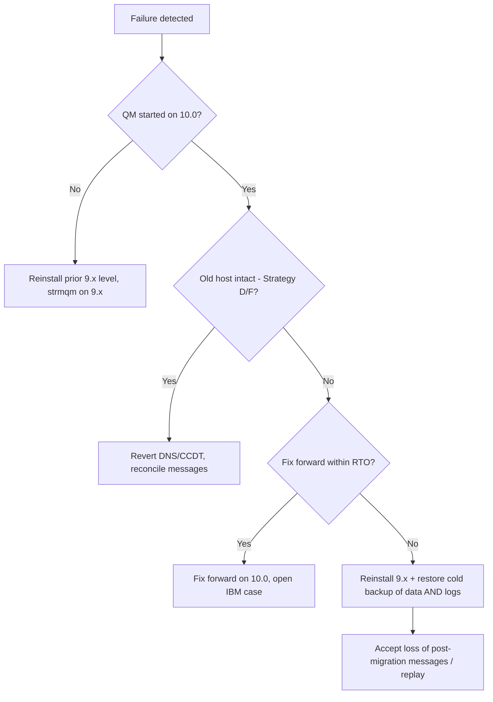
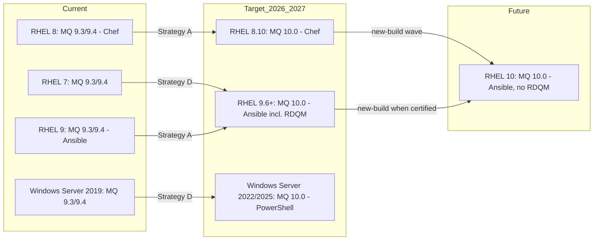
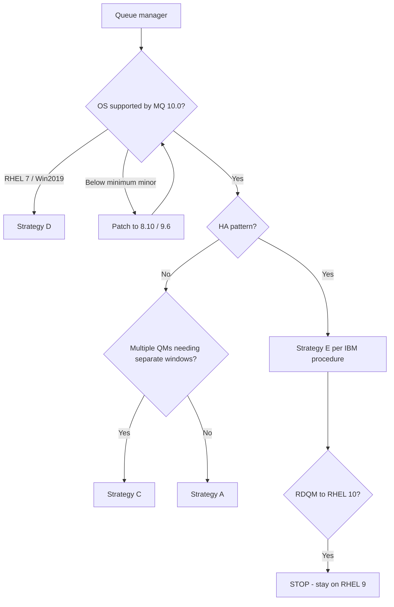
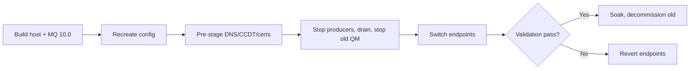
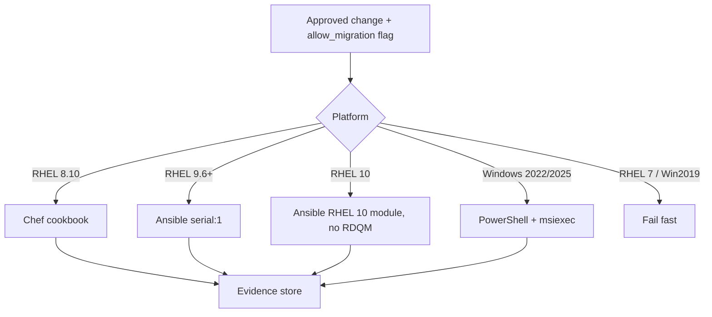

# IBM MQ v9.3/v9.4 to v10.0 Enterprise Upgrade Strategy (RHEL 7/8/9/10 and Windows Server 2019)

**Recommendation:** go ahead with the IBM MQ 10.0 upgrade now, but only on RHEL 8.10 and RHEL 9 (9.6 or later).
- **RHEL 7 is a hard blocker.** MQ 10.0 does not list it, and MQ 9.4 had already dropped it.
- **Windows Server 2019 should be treated as unsupported** until IBM confirms otherwise. It does not appear in the MQ 10.0 platform list I could read.
- **RHEL 10 is a supported future platform** for base MQ 10.0, but not for RDQM.

## TL;DR
- **The target exists and is supported.** IBM MQ 10.0 LTS has been generally available since 16 June 2026 under IBM's "Support Cycle-5" policy: 5 years of standard support, then 1 year of critical fixes, then 3 years of usage and existing fixes. IBM's 10.0 compatibility report lists RHEL 8 (8.10 minimum), RHEL 9 (9.6 minimum on IBM Z/Power; the x86-64 minimum still needs confirming) and RHEL 10 (base). It lists Windows Server 2022 and 2025. Neither RHEL 7 nor Windows Server 2019 appeared in the parts of the report I could read.
- **Recommended pattern:**
  - On RHEL 9 (Ansible) and RHEL 8.10 (Chef), upgrade in place, one queue manager at a time.
  - Take a verified cold backup before each queue manager's first `strmqm` under 10.0.
  - Move RHEL 7 and Windows Server 2019 queue managers to new RHEL 9 or Windows Server 2022/2025 hosts (Strategy D).
  - Never run an OS upgrade and an MQ upgrade in the same window.
- **Rollback is limited.** IBM states that on Multiplatforms you "cannot easily revert to a previous version". Once a queue manager has started under 10.0, the only supported rollback is to reinstall the old binaries and restore the pre-migration backup. Any messages processed after the migration are lost. Treat the first start under 10.0 as the point of no return, with a formal approval gate.

**Evidence limits:** IBM's documentation site (ibm.com/docs, 10.0.x) blocked automated retrieval. The 10.0 compatibility report could only be read through search snippets. Items that depend on those pages are marked "to confirm" and are listed as IBM support-case questions in §11.3.

---

## 1. Executive summary and recommended approach

**Decision:** approve the MQ 10.0 programme, but run it platform by platform rather than as one procedure for the whole estate.

| Segment | Verdict | Recommended path |
|---|---|---|
| RHEL 9 (Ansible), MQ 9.3/9.4 | Proceed | Raise the OS to 9.6 or later, then Strategy A (in-place, single-stage upgrade to 10.0.0.x LTS) |
| RHEL 8 (Chef), MQ 9.3/9.4 | Proceed once the OS prerequisite is met | Raise the OS to RHEL 8.10, then Strategy A. RHEL 8 Maintenance Support ends 31 May 2029, so plan the later move to RHEL 9/10 as a separate wave |
| RHEL 7, MQ 9.3 | Blocked in place | Strategy D: new RHEL 9.6+ host with MQ 10.0 |
| RHEL 7, MQ 9.4 | Already an unsupported combination today | Strategy D as a priority remediation |
| Windows Server 2019, MQ 9.3/9.4 | Blocked in place, pending IBM confirmation | Strategy D: new Windows Server 2022/2025 host |
| RHEL 10 | Future state | Supported for base MQ 10.0. Adopt by building new hosts (Strategy D) once the Ansible RHEL 10 role is certified. Not for RDQM |

**Why this approach:**
- Every step stays inside documented IBM and Red Hat support boundaries.
- The reversible step (installing binaries) is kept separate from the irreversible one (queue manager data migration at first start).
- Chef and Ansible are reused within their stated OS boundaries.
- New infrastructure spend is limited to the two segments that cannot be upgraded in place.

**Urgency:**
- IBM MQ 9.3.x reaches end of standard support on 30 September 2027. Extended support runs to 30 September 2031.
- IBM has published no end-of-support date for MQ 9.4.x (lifecycle page updated 16 February 2026). Its Support Cycle-5 policy and GA date of 18 June 2024 suggest standard support until at least mid-2029, but that is my inference, not an IBM date.
- All 9.3 queue managers should therefore be on 10.0 before Q3 2027.

---

## 2. Critical findings and blockers

| # | Finding | Severity | Evidence status |
|---|---|---|---|
| B1 | MQ 10.0 does not list RHEL 7. RHEL 7 left Red Hat Maintenance Support on 30 June 2024 and can now only be patched under the paid ELS add-on, which runs to 31 May 2029. | Blocker | Confirmed (IBM 10.0 system requirements; Red Hat lifecycle and ELS announcement) |
| B2 | MQ 9.4 on RHEL 7 is already unsupported. MQ 9.4 raised the RHEL minimum to 8.8, and IBM's 9.4.5 CD notes list RHEL 7.9 among removed levels. | Blocker (risk in today's estate) | Confirmed (IBM 9.4 requirements; IBM Community 9.4.5 notes) |
| B3 | The MQ 10.0 Windows list I could see shows Windows 11, Windows Server 2022 and Windows Server 2025, but not Windows Server 2019. The 10.0 GA blog has no "removed operating systems" table. | Blocker pending IBM confirmation | Not yet verifiable |
| B4 | MQ 10.0 raises the minimum OS levels: RHEL 8 must be at 8.10, and RHEL 9 at 9.6 (shown for IBM Z; x86-64 to confirm). | Prerequisite | Partly confirmed |
| B5 | RDQM on RHEL 10 is not supported. IBM's footnote: "RHEL 10 is not currently supported and MQ does not include a DRBD kmod for this operating system release." IBM's validated kernel-module page (modified 7 October 2026) lists RHEL 7, 8 and 9 only. | Blocker for RDQM on RHEL 10 | Confirmed |
| B6 | On Multiplatforms, going back is not a simple downgrade. IBM: queue managers started at the later level "will not work with the restored level"; you must first back up, then restore. | Design constraint | Confirmed in 9.x documentation; 10.0.x wording to confirm |
| B7 | On Linux, `rpm -U` from 9.3 works only if "the last fix applied (if any) must be a manufacturing refresh". Hosts patched with separate fix-pack packages (names containing `U`) must be uninstalled and reinstalled instead. | Automation prerequisite | Confirmed for 9.3; 10.0 to confirm |
| B8 | IBM's release-type planning table says queue managers on a CD release with a non-zero modifier (for example 9.4.5 CD) cannot be migrated backwards. 9.3.0 LTS and 9.4.0 LTS show "Backwards migration supported", but that table appears to be the z/OS one. | Constraint | Confirmed for z/OS; apply cautiously to Multiplatforms |
| B9 | IBM documents no Leapp in-place OS upgrade with MQ installed. Red Hat supports Leapp only "from one major RHEL version to the next consecutive one", on tested minor-version pairs (8.10→9.6/9.8; 9.6→10.0; 9.8→10.2). | Risk | Red Hat confirmed; no IBM statement found |

**Do not proceed** on any host where B1, B2, B4 or B5 applies, or where B3 is still unresolved.

---

## 3. Target-version availability and OS compatibility matrix

**MQ 10.0 availability (verified):**
- Generally available 16 June 2026 (announcement AD26-0278, PID 5724-H72).
- LTS updates are numbered 10.0.0.x. Version 10.0.0.5 is the latest LTS level validated on IBM's RDQM kernel-module page, and the IBM download page lists 10.0.0.5 (CSU) as the latest LTS release.
- CD releases are numbered 10.0.x.
- The Linux x86-64 base image is Passport Advantage part M11G1ML; the Windows image is M11FYML. On Windows and Linux, maintenance releases include the base install.

### 3.1 OS × MQ supportability (queue manager, x86-64)

| OS | MQ 9.3 LTS | MQ 9.4 LTS | MQ 10.0 LTS |
|---|---|---|---|
| RHEL 7 | Supported only with prerequisites: 7.9, and the OS needs Red Hat ELS | Unsupported | Unsupported (not listed) |
| RHEL 8 | Officially supported (8.4+) | Officially supported (8.8+) | Supported with prerequisites (8.10 minimum) |
| RHEL 9 | Supported with prerequisites: 9.3.0.2 or later, installed from a refresh image (installing 9.3.0.0 and then applying a fix pack is not supported) | Officially supported (9.2+) | Supported with prerequisites (9.6 shown for IBM Z; x86-64 to confirm) |
| RHEL 10 | Unsupported (not listed) | Not yet verifiable for LTS. RHEL 10 was added in the 9.4.5 CD release | Officially supported for base MQ (rows at "Base" level). RDQM unsupported |
| Windows Server 2019 | Officially supported | Officially supported (9.4.x, 9.4.3) | Not yet verifiable; plan as unsupported |
| Windows Server 2022/2025 (targets) | 2022 supported | 2022 supported | Officially supported (2022 and 2025, Standard and Datacenter) |

### 3.2 RHEL 10 questions

| Question | Answer | Basis |
|---|---|---|
| Does MQ 10.0 support RHEL 10? | Yes, at base level. Rows cover the queue manager, client, AMQP, Internet Pass-Thru (MQIPT), Resource Adapter and Web Server. IBM extends defect support to environments "fully compatible, both source and binary, with Red Hat Enterprise Linux 9 or 10". | IBM 10.0 system requirements page (16 June 2026) and compatibility report |
| Does support depend on minor release, architecture or MQ level? | Minimum is RHEL 10 base and MQ 10.0. IBM Z and Power LE rows were seen; the x86-64 row should be confirmed. 31-bit applications are not supported on IBM Z. | Compatibility report |
| Does client support differ from server support? | No difference seen. RDQM is the exception: unsupported. | Compatibility report footnotes |
| Do prerequisites or security integration change? | IBM documents only its SELinux support footnote. RHEL 10 uses kernel 6.12 and OpenSSL 3.5. A secondary source says MQ's TLS uses its own bundled GSKit library, so RHEL crypto policy should not govern MQ channel TLS. Validate this in the PoC. Also check that 32-bit libraries are available if needed. | Engineering judgment; PoC required |
| Can RHEL 9 be upgraded to 10 with MQ installed? | Red Hat supports Leapp from 9.6→10.0 and 9.8→10.2. IBM says nothing about MQ surviving a Leapp upgrade. | Red Hat upgrade guide; IBM gap |
| Upgrade MQ before or after the OS? | MQ first. MQ 10.0 is the only LTS release supported on both RHEL 9 and RHEL 10, so it is the bridge. | Derived from the matrix |
| Keep the installation or reinstall? | Preferred: build a new RHEL 10 host, install MQ 10.0 fresh, then move or recreate the queue managers. | Engineering judgment |
| Does IBM document a RHEL 9→10 path for MQ? | No IBM document found. | Support-case question Q5 |

---

## 4. Source-version-to-target upgrade-path matrix

What the sources support:
- A queue manager's data is migrated automatically, and irreversibly, the first time it is started (`strmqm`) under a release with a new command level. MQGem, a community source, reports MQ 10.0 as command level 1000.
- IBM's 10.0 release-type table lists 9.3.0 LTS → 10.0 and 9.4.0 LTS → 10.0 as paths.
- IBM's end-of-support notices say 9.2 queue managers "can be updated directly to the latest version of IBM MQ".

On that basis, direct migration from 9.3 and 9.4 on Multiplatforms is rated **Supported with prerequisites**, until IBM's 10.0.x "Migration paths" page can be read in full.

| Source MQ | Current OS | Target | Target supports this OS? | Direct in-place upgrade? | Intermediate version needed? | Recommended action |
|---|---|---|---|---|---|---|
| 9.3 | RHEL 7 | 10.0 | Unsupported | No (OS blocker) | No MQ intermediate; an OS change is mandatory | Strategy D to RHEL 9.6+ |
| 9.3 | RHEL 8 | 10.0 | Supported with prerequisites (8.10) | Supported with prerequisites | No | RHEL 8.10, then Strategy A (Chef) |
| 9.4 | RHEL 7 | 10.0 | Unsupported | No | Not applicable (source already unsupported) | Strategy D, priority wave |
| 9.4 | RHEL 8 | 10.0 | Supported with prerequisites (8.10) | Supported with prerequisites | No | RHEL 8.10, then Strategy A (Chef) |
| 9.3 / 9.4 | RHEL 9 | 10.0 | Supported with prerequisites (9.6) | Supported with prerequisites | No | RHEL 9.6+, then Strategy A (Ansible) |
| 9.3 / 9.4 | Windows Server 2019 | 10.0 | Not yet verifiable (plan as unsupported) | No (pending) | No | Strategy D to Windows Server 2022/2025 |
| 10.0 | RHEL 9 | RHEL 10 (OS only) | Officially supported | Not documented by IBM | No | Prefer a new RHEL 10 build and move the queue managers |
| 9.4.x CD (e.g. 9.4.5) | Any | 10.0 | As per the OS rows | Yes, but irreversible | No | The backup is the only rollback |

**Prerequisites for every "Supported with prerequisites" row:**
- Source at the latest LTS maintenance level. At 10.0 GA, IBM listed 9.3.0.40 and 9.4.0.21; IBM's kernel-module page now shows validated levels 9.3.0.42 and 9.4.0.26.
- Queue manager ended cleanly.
- A backup that has been restore-tested.
- IBM's 10.0 "Changes that affect migration" topic reviewed.

### 4.1 Future-state RHEL scenarios

| # | Scenario | What the evidence shows | Verdict |
|---|---|---|---|
| 1 | RHEL 8 → 9 → 10, upgrading MQ along the way | Red Hat supports each Leapp hop. Only MQ 10.0 is supported on RHEL 10. | Viable only as: MQ 10.0 on RHEL 8.10, then Leapp to 9, then Leapp to 10. That is three outages, and IBM does not document MQ across Leapp. **Not recommended** |
| 2 | RHEL 8 → 10 directly | Red Hat allows in-place upgrades only between consecutive major versions | **Unsupported**. Use scenario 4 |
| 3 | MQ 10.0 on RHEL 9 → RHEL 10, OS only | MQ 10.0 is supported on both ends; IBM says nothing about Leapp | Technically possible but needs an IBM support case. Prefer scenario 4 |
| 4 | New RHEL 10 hosts with MQ 10.0, then move queue managers or applications | Within documented support for base MQ | **Recommended future-state pattern** (not for RDQM) |
| 5 | Temporary RHEL 9 landing platform | MQ 10.0 supported on RHEL 9.6+; RHEL 9 Maintenance Support runs to 31 May 2032 | **Recommended now for RHEL 7 and RDQM workloads** |

---

## 5. Migration strategy comparison

| Strategy | How it works | Keeps queue manager identity and data? | Applies to | Status |
|---|---|---|---|---|
| A. In-place | Replace the binaries, then the data migrates at `strmqm` | Yes | RHEL 8.10, RHEL 9.6+ | **Primary** |
| B. In-place MQ plus OS upgrade | Leapp OS hop and MQ upgrade in separate windows | Yes, but IBM has not tested this | RHEL 7→8, 8→9, 9→10 | Needs an IBM case; **not recommended** |
| C. Side-by-side on the same host | Install 10.0 as a second installation, then move each queue manager with `setmqm` | Yes | RHEL hosts with several queue managers | **Viable** |
| D. Parallel server | New host with MQ 10.0; recreate the configuration, or move the data if IBM confirms that is supported; redirect endpoints | Recreate: no (new queue manager ID). Data move: yes, if IBM confirms (Q3) | RHEL 7, Windows 2019, RHEL 10 adoption | **Mandatory for the blocked segments** |
| E. HA/DR-assisted | Upgrade the standby first for multi-instance; node by node for RDQM; replicas first for Native HA | Yes | Wherever HA is deployed | Reduces downtime but does not eliminate it |
| F. Recreate the queue manager | `dmpmqcfg` export, `crtmqm`, replay with `runmqsc`, then drain or forward messages | No | Fallback for D | Viable, but it is an application-level migration |

**Strategy A: in-place.**
- Single-stage migration replaces the existing installation. Uninstalling with rpm does not delete `/var/mqm`.
- Exits must be 64-bit and recertified against 10.0.
- Since MQ 9.4, the AMQP service no longer starts automatically with the queue manager.
- Rollback before the first `strmqm`: uninstall 10.0 and reinstall the old level. IBM documents this as possible when the queue manager has not been started.
- Rollback after the first `strmqm`: old binaries plus the pre-migration backup.

**Strategy B: OS and MQ upgrades.**
- Never in the same window.
- RHEL 8: MQ 10.0 on 8.10 first, let it stabilise, then Leapp to 9.6/9.8 in a later window.
- RHEL 7: Leapp 7.9→8.10 while still on MQ 9.3 (supported on both), then MQ 10.0. That is two hops on legacy infrastructure, so prefer Strategy D.
- RDQM DRBD kernel modules must match the new kernel.
- Rolling back an OS hop needs a VM snapshot or bare-metal restore.

**Strategy C: side-by-side.**
- Installing the second version changes nothing for the running queue managers. The irreversible step is `setmqm` followed by `strmqm`.
- Risks: libraries loaded from fixed paths or `LD_LIBRARY_PATH`; scripts that call `/opt/mqm/bin` directly; the primary installation's links (`setmqinst`); exits loaded per installation.

**Strategy D: parallel server.**
- Point connection names and client channel definition tables (`CONNAME`/CCDT) at DNS aliases or load-balancer VIPs.
- Reissue TLS certificates with the new host names (SANs).
- For cluster changes: a recreated queue manager gets a new queue manager ID (QMID). Suspend the old instance and remove it from the cluster cleanly.
- Keep the old host intact until sign-off.

**Strategy E: HA patterns.**

| Pattern | Mixed versions | Order | Effect on downtime | Rollback |
|---|---|---|---|---|
| Multi-instance | Not supported concurrently. Once 10.0 starts the queue manager, its data is migrated | Upgrade the standby; `endmqm -s` on the active; the 10.0 instance takes over and migrates the data; then upgrade the former active and restart it as standby | One switchover plus migration time | Backup only |
| RDQM HA | Follow IBM's "Migrating replicated data queue managers" procedure (confirm for 10.0); kernel module must match | Secondary nodes first | One failover | Backup only; never on RHEL 10 |
| RDQM DR | IBM procedure: recovery node first (confirm) | Recovery node, then primary | DR protection is reduced during the upgrade | The DR copy is not a rollback |
| Native HA | Replicas first, then the leader (confirm for 10.0). 10.0 adds two DR options: In-Region Replication (IRR, 2 nodes, manual switch to the recovery site) and Cross-Region Replication (CRR, 6 nodes) | Replicas, then leader | Brief leader change | Backup only |

**Strategy F: recreation.**
- `dmpmqcfg` captures objects, authority records, channel authentication (CHLAUTH) rules and AUTHINFO objects.
- It does **not** capture messages, the queue manager ID, `qm.ini` tuning, keystores or exits.
- It is not a full queue manager migration.

---

## 6. IBM tools and utilities inventory

| Tool | Category | When and why it is used | Limitations |
|---|---|---|---|
| `mqlicense.sh -accept`; `rpm -ivh` / `rpm -Uvh` / `rpm --prefix` | Binary upgrade | Installing and upgrading on RHEL | `-U` from 9.3 only from a manufacturing refresh. Known 9.4.0.10 issue: installs in a top-level directory fail a direct upgrade |
| `crtmqfp` | Binary upgrade | Repackaging a fix pack for a second installation on the same host | Only needed with multiple installations |
| `msiexec` silent install with a response file | Binary upgrade | Windows installs | Properties must be checked against the 10.0 Windows documentation |
| `setmqm` | Queue manager migration step | Associates a queue manager with a different installation | The actual migration happens at `strmqm` |
| `strmqm` | Queue manager data migration | First start under 10.0 migrates the data | Irreversible |
| `dspmqver`, `dspmqinst`, `dspmq -o all`, `dspmq -x` | Readiness checks | Discovery and post-upgrade checks | — |
| `setmqinst`, `setmqenv` | Environment | Setting the primary installation and the shell environment | Affects links and PATH |
| `dmpmqcfg`, `runmqsc` | Configuration export and recreation | Capture and replay of configuration | Not a full migration |
| `endmqm -w` / `-i` / `-s` | Queue manager control | Controlled stop; `-s` switches over to a standby instance | `-s` only for multi-instance |
| Cold copy of the data and log directories; `rcdmqimg` (linear logging) | Backup and recovery | The only rollback after migration | Queue manager must be stopped |
| `rdqmstatus`, `rdqmadm`, `modver` | HA tooling | RDQM status and choosing the correct kernel module | No RHEL 10 kernel module |
| `runmqakm`, `runmqktool` | Security | Keystore management | `runmqckm` and `strmqikm` were removed in 9.4 |
| IBM Software Product Compatibility Reports | Readiness gate | Authoritative OS check | Always select the latest maintenance level |
| Fix Central `10.0.0-IBM-MQ-RDQM-Kmods` | Prerequisite | Validated DRBD kernel modules | Use only kernels IBM has validated |
| Red Hat Leapp | OS upgrade (Red Hat tool) | Major-version OS hops | One major version per hop; does not cover MQ |

IBM provides no single utility that moves a queue manager to a new host and a new version in one step. Anything in the estate that does this is custom tooling.

---

## 7. Detailed runbooks

Command labels:
- **[V]** documented in IBM or Red Hat documentation for 9.x or RHEL.
- **[C]** needs confirming against the MQ 10.0 documentation.
- **[P]** illustrative pseudocode.

### 7.1 Discovery (all strategies)

**Linux:**
1. [V] Versions and installations: `dspmqver -a`; `dspmqinst`; `dspmq -o all`; `dspmq -x`.
2. [V] Configuration files: `cat /var/mqm/mqs.ini` and `cat /var/mqm/qmgrs/<QM>/qm.ini`.
3. [V] Configuration and authorities: `dmpmqcfg -m <QM> -a -o mqsc > <QM>.mqsc`; `dmpmqcfg -m <QM> -a -o setmqaut > <QM>.aut`.
4. [V] Channels, security and connections via `runmqsc`:
   - `DIS CHSTATUS(*) ALL`
   - `DIS CHL(*) SSLCIPH`
   - `DIS CHLAUTH(*)`
   - `DIS QMGR SSLKEYR CERTLABL CONNAUTH CMDLEVEL`
   - `DIS CONN(*) TYPE(CONN) APPLTAG`
5. [V] OS and packages: `cat /etc/redhat-release; uname -r; rpm -qa | grep MQSeries`. Look for fix-pack packages whose names contain `U`.
6. [V] RDQM state: `rdqmstatus -m <QM>`.
7. [P] Exits: list them from `qm.ini` and the channel definitions, and check each with `file` to confirm it is 64-bit.
8. Record the Chef cookbook and Ansible role versions, plus their attributes and variables.

**Windows:**
1. Run the same `dspmq*` and `dmpmqcfg` commands.
2. [P] `Get-Service *MQ*`.
3. Record the service account and the `C:\ProgramData\IBM\MQ` paths.

**Version differences:**
- `runmqckm` and `strmqikm` no longer exist from 9.4.
- From 9.4, maintenance on Linux and Windows is applied by upgrading, not by overlaying fix packs.

### 7.2 Readiness checklist

| Check | Pass criterion | If it fails |
|---|---|---|
| OS level | RHEL ≥ 8.10 or ≥ 9.6, RHEL 10, or Windows Server 2022/2025 | Stop |
| Source MQ level | Latest 9.3.0.x or 9.4.0.x LTS fix pack or CSU | Apply maintenance first |
| Installation media | Checksum and signature verified | Stop |
| Entitlement | Entitlement covers MQ 10.0 (MQ Advanced where RDQM, Native HA or AMS is used) | Stop |
| Queue manager health | Running; no FDC files in the last 7 days; channels RUNNING; dead-letter queue depth baseline recorded | Investigate |
| Disk | Install filesystem has ≥ 2× the installation size free; log filesystem has ≥ 25% headroom | Extend |
| Backup | Cold backup after a clean `endmqm`, with a restore proven in non-production | Stop |
| Configuration capture | `dmpmqcfg` output stored with a checksum | Stop |
| TLS | No RSA key-exchange CipherSpecs (deprecated and disabled by default from 9.4.1); no SSL 3.0 or TLS 1.0; CMS keystores converted to PKCS#12 where AMQP is used | Remediate |
| Clients | Client versions inventoried; Java applications not using the JRE bundled with MQ | Plan remediation |
| Exits and monitoring | 64-bit and certified for 10.0 | Stop |
| Change approval | Change board (CAB), rollback plan and business contacts approved | Stop |

### 7.3 Strategy A runbook (RHEL 8.10 with Chef, RHEL 9.6+ with Ansible)
1. Freeze configuration changes and confirm the readiness checklist is green.
2. Stop inbound traffic (application controls or `STOP CHANNEL(...) MODE(QUIESCE)`). Check transmission-queue depths are empty or acceptable.
3. [V] `endmqm -w <QM>`, then confirm "Ended normally" with `dspmq`.
4. [V] Use `fuser` or `lsof` on the MQ library directory to confirm no processes still have MQ libraries loaded.
5. Take a cold backup of the data and log directories and record a checksum. **Gate G1: backup verified.**
6. [V] Run `./mqlicense.sh -accept`.
7. Install the binaries:
   - From 9.4: [C] `rpm -Uvh MQSeries*.rpm` (add `--prefix` for a non-default path).
   - From 9.3 with separate fix-pack packages: [V] remove them with `rpm -ev`, then [C] `rpm -ivh` the 10.0 packages.
8. [V] Confirm `dspmqver` reports 10.0.0.x. Run `setmqinst` if this should be the primary installation.
9. Update the RDQM kernel module if RDQM is used (`modver`).
10. **Gate G2: point of no return.** Aborting here means reinstalling the old level; no data restore is needed.
11. [V] `strmqm <QM>`. Check `AMQERR01.LOG` and `DIS QMGR CMDLEVEL VERSION`.
12. Restart channels and listeners. Re-enable the AMQP service if it is used.
13. Run the §7.8 validation, then release traffic in stages.

### 7.4 Strategy C runbook (side-by-side)
1. [C] Install 10.0 alongside the existing version, with the queue managers still running: `rpm --prefix /opt/mqm10 -ivh MQSeries*.rpm`. Run [V] `crtmqfp` if needed.
2. [V] Confirm both installations with `dspmqinst`.
3. For each queue manager:
   - Steps 2–5 of §7.3.
   - [V] `endmqm -w QM`
   - `/opt/mqm10/bin/setmqm -m QM -n <Installation2>`
   - `. /opt/mqm10/bin/setmqenv -s`
   - `strmqm QM` (irreversible)
4. Update service units, PATH and application library paths.
5. Remove the 9.x installation after the soak period.

### 7.5 Strategy D runbook (parallel server)
1. Build the new host with the automation in §8 and install MQ 10.0.
2. Recreate the queue manager: `crtmqm` with the same name and matching log settings; `runmqsc QM < QM.mqsc`; apply the `setmqaut` output; import certificates into a PKCS#12 keystore. Move the data instead only if IBM answers Q3 positively.
3. Pre-stage DNS or VIP changes, CCDT entries, and certificates with the new host names.
4. Cutover:
   - Stop producers.
   - Drain queues to zero, or forward the remaining messages.
   - Stop the old queue manager but keep it intact.
   - Switch DNS or the CCDT.
   - Start channels and reconnect applications.
5. Cluster changes: add the new queue manager, then `SUSPEND QMGR CLUSTER` on the old one. Remove the old one after validation.
6. Validate, and keep the old host until the rollback window expires.

### 7.6 Strategy E runbook (multi-instance) [C]
1. Upgrade the binaries on the standby host.
2. [V] Run `endmqm -s <QM>` on the active host, so the 10.0 standby takes over and migrates the data.
3. Upgrade the former active host and restart it with `strmqm -x`.
4. Never start a 9.x instance against migrated data.

### 7.7 Windows runbook (Windows Server 2022/2025, Strategy D)
1. [C] Silent install, for example: `msiexec /i "<media>\MSI\IBM MQ.msi" /l*v install.log /q TRANSFORMS="1033.mst" AGREETOLICENSE="yes" ADDLOCAL="Server,Client" INSTALLATIONNAME="Installation1"`. Validate every property against the 10.0 documentation.
2. Configure the service account, firewall and listener.
3. Recreate the queue manager as in §7.5 step 2.
4. Cut over as in §7.5.

### 7.8 Post-upgrade go/no-go

| Check | Success criterion |
|---|---|
| Version and command level | `dspmqver` shows 10.0.0.x; `CMDLEVEL` shows the 10.0 level |
| Logs | No new FDC files or TLS AMQ9xxx errors within 60 minutes |
| Channels and listeners | 100% of expected channels RUNNING |
| Clients | Connection count ≥ 95% of the baseline |
| Messages | Persistent put/get round-trip succeeds; queue depths match the pre-upgrade snapshot |
| Security | CHLAUTH and CONNAUTH behaviour unchanged; negative tests are blocked |
| Exits, monitoring, backup | Exit-dependent flows pass; test alerts fire; first post-upgrade backup completed |
| Performance | Throughput and latency within 10% of the baseline |
| Business | Application owner sign-off |

---

## 8. Chef, Ansible and Windows automation design

### 8.1 Who changes what

| Category | RHEL 8 (Chef) | RHEL 9 / RHEL 10 (Ansible) | Windows Server 2022/2025 |
|---|---|---|---|
| Reusable as is | Package resources, users and groups, kernel limits, service units, applying MQSC | Equivalent existing roles | Nothing assumed |
| Required changes | 10.0 media and version attributes; choice between upgrade and fresh install; removal of separate 9.3 fix-pack packages; OS gate ≥ 8.10 | 10.0 variables; OS gate ≥ 9.6; RHEL 10 conditional tasks | — |
| New automation | Pre-check and post-check recipes; evidence capture; guard that blocks `strmqm` unless approved | Pre/post-check roles; one-host-at-a-time orchestration; RHEL 10 OS module | PowerShell module wrapping the `msiexec` silent install, deployed through the enterprise's existing Windows software-distribution tool |
| Stays manual | Approvals at G1 and G2; backup restore tests; cluster and partner CONNAME changes | Same | Same |
| Prerequisites | RHEL 8.10; media; entitlement | RHEL 9.6+; Ansible collection versions | OS build; service accounts |

### 8.2 Chef (RHEL 8)
- **Attributes:** `target_version`, `media_url`, `media_sha256`, `install_path`, `installation_name`, `upgrade_mode`, and `allow_migration` (default `false`).
- **Recipe order:** `precheck` → `install` → gated `strmqm` → `postcheck`.
- **Idempotency:** guard each step on the `dspmqver` output. Never run `crtmqm` or `dltmqm` from an upgrade recipe.
- **On failure:** leave the queue manager stopped and alert. Never roll forward automatically.

### 8.3 Ansible (RHEL 9, plus a RHEL 10 module)
```yaml
# [P] Illustrative — package names and flags to be confirmed against MQ 10.0
- hosts: mq_wave_n
  serial: 1
  any_errors_fatal: true
  roles:
    - mq_os_gate      # support map {RedHat-8: '8.10', RedHat-9: '9.6', RedHat-10: '10.0'}; fail on RHEL 7
    - mq_precheck
    - mq_quiesce
    - mq_backup
    - mq_install
    - role: mq_migrate
      when: mq_allow_migration | bool
    - mq_postcheck
```
- **Check mode** is valid only for the gates and pre-checks. Guard the `rpm` and `strmqm` tasks with `when: not ansible_check_mode`.
- **Retries:** only for downloads and status polling, never for `strmqm`.
- **Handlers:** none may restart queue managers implicitly.
- **RHEL 10 items to validate:**
  - OS detection
  - repositories and `dnf` behaviour
  - 32-bit library availability
  - SELinux policy
  - systemd hardening
  - crypto policy
  - a hard block on deploying the RDQM role

### 8.4 Windows
Do not assume Chef or Ansible is available on Windows. Use a version-controlled PowerShell module that:
1. checks the OS build against the support map;
2. stops the queue managers and services;
3. runs the IBM-documented `msiexec` silent install;
4. runs the post-checks;
5. writes a transcript to the evidence store.

---

## 9. Downtime and service-impact estimates

**Assumptions:**
- Logs under 20 GB and fewer than 100 channels per queue manager.
- Queues drained before shutdown.
- SSD-class storage.
- Automation staged in advance and rehearsed.

These ranges are engineering judgment, **not IBM guarantees**. Recovery at restart scales with the amount of log to replay and the volume of persistent messages.

| Strategy | Combination | Planned outage | Possible extended outage | Traffic interruption | Rollback time | Key assumption |
|---|---|---|---|---|---|---|
| A | RHEL, from 9.4 | 45–90 min | 3–4 h | Full outage per queue manager | 60–120 min | `rpm -U` works |
| A | RHEL, from 9.3 with separate fix packs | 60–120 min | 4 h | Full | 60–120 min | Uninstall and reinstall |
| C | RHEL host with several queue managers | 15–45 min per queue manager | 2 h | Per queue manager | 30–90 min | Binaries installed beforehand |
| D | RHEL 7 / Windows 2019 to a new host | 30–90 min cutover | 4–6 h | Endpoint switch | 15–30 min (point DNS back) | DNS TTL ≤ 5 min; queues drained |
| E | Multi-instance / RDQM | 5–20 min | 2 h | Brief, with client reconnect | 60–120 min | Clients reconnect automatically |
| B | Each Leapp hop | 2–4 h | 8 h or a rebuild | Full | 1–3 h (snapshot restore) | Separate window |

**Typical Strategy A breakdown:**
- Preparation: online, no outage.
- Drain: 10–20 min.
- Shutdown: 1–5 min.
- Binary install: 10–25 min.
- Data migration at first start: seconds to minutes.
- Startup and recovery: 2–10 min.
- Validation: 20–40 min.
- Application reconnection: 5–10 min.
- Rollback reserve: 60–120 min.

**Definitions:**
- **MQ service downtime:** the queue manager is not running.
- **Transaction interruption:** applications cannot complete work. This is longer than service downtime because it includes draining and reconnection.
- **Full outage:** both of the above.
- **Staged migration:** one queue manager or node at a time.
- **No HA pattern guarantees zero downtime.**

**How to measure:** rehearse on a production-sized clone, timestamp each step, run three iterations, and plan with the 90th-percentile time plus 50%.

---

## 10. Rollback and disaster recovery

| Strategy | Last safe point | Supported rollback | Irreversible step | Data risk |
|---|---|---|---|---|
| A | Before the first `strmqm` (G2) | Before G2: reinstall the old level. After G2: old binaries plus the cold backup | First `strmqm` | Messages processed after migration are lost; replaying them risks duplicates |
| B | Before the Leapp reboot | Snapshot or bare-metal restore | Leapp upgrade | Whole system |
| C | Before `setmqm` + `strmqm` | Run `setmqm` back only if the queue manager has not been started; otherwise restore the backup | `strmqm` | As A |
| D / F | Until the old queue manager is decommissioned | Point DNS or the CCDT back to the old queue manager | Decommissioning or `dltmqm` | Messages written to the new queue manager must be reconciled |
| E | Before switchover to 10.0 | Restore the backup on both nodes | First start under 10.0 | The DR replica is migrated too, so it is not a rollback |

**Rejected as invalid rollbacks:**
- Starting a migrated queue manager on 9.x binaries.
- Using a standby instance or a DR copy to go back a version.
- Restoring the data directory without its matching log directory.



---

## 11. Risks, assumptions, gaps and unresolved questions

### 11.1 Risk register

| ID | Risk | Likelihood / Impact | Mitigation |
|---|---|---|---|
| R1 | Windows Server 2019 confirmed unsupported late in the programme | High / High | Budget Windows Server 2022/2025 builds now |
| R2 | No rebuild capacity for RHEL 7 hosts | Medium / High | Make Strategy D an early wave |
| R3 | `rpm -U` fails on 9.3 hosts patched with separate fix packs | High / Medium | Uninstall-and-reinstall path in the automation |
| R4 | Deprecated RSA key-exchange ciphers break partner channels | Medium / High | Cipher audit and coordination with partners |
| R5 | Exits or monitoring agents not certified for 10.0 | Medium / High | Make certification a gate |
| R6 | RDQM placed on RHEL 10 | Medium / Critical | Ansible OS gate blocks it |
| R7 | Leapp upgrade with MQ installed fails in ways IBM will not support | Medium / High | Prefer new builds |
| R8 | Messages lost when rolling back after G2 | Low / High | Drain queues first; formal G2 approval |
| R9 | RHEL kernel not validated for RDQM | Medium / High | Pin kernels to IBM-validated levels (RHEL 9 kernels 5.14.0-570.12.1 to 570.15.1 are flagged by IBM) |
| R10 | RHEL 8 Maintenance Support ends 31 May 2029 | Certain / Medium | Plan the RHEL 9/10 wave for 2027–2028 |
| R11 | MQ 9.4.4 CD support ends 16 October 2026; 9.4.5 CD ends 5 February 2027 | Certain / Medium | Move any CD queue managers first |

### 11.2 Assumptions
- All hosts are x86-64.
- Storage is local or NFSv4.
- Entitlements cover 10.0, with MQ Advanced wherever RDQM or Native HA is used.

### 11.3 IBM support-case questions (answer before production)
- **Q1:** Is Windows Server 2019 supported for the MQ 10.0 server or client at any maintenance level?
- **Q2:** Confirm direct migration on Multiplatforms from 9.3.0.x and 9.4.0.x LTS to 10.0.0.x, and IBM's 10.0.x position on going back to an earlier version.
- **Q3:** Is it supported to restore a 9.x queue manager's backup on a different RHEL host and then start it under 10.0?
- **Q4:** What are the x86-64 minimum RHEL minor versions for MQ 10.0 (9.6? 8.10?), and is RHEL 7 absent?
- **Q5:** Is an MQ 10.0 installation supported after a Leapp upgrade from RHEL 9 to 10?
- **Q6:** Is `rpm -U` from 9.4.0.x and from 9.3.0.x (manufacturing refresh) to 10.0.0.x supported?
- **Q7:** Is there a roadmap for RDQM on RHEL 10?
- **Q8:** Is MQ 9.4 LTS (as opposed to the 9.4.5 CD release) supported on RHEL 10?

---

## 12. Architecture and workflow diagrams

### 12.1 Current and target state


### 12.2 Choosing a strategy


### 12.3 In-place upgrade workflow
```mermaid
sequenceDiagram
  participant Ops
  participant Auto as Chef/Ansible
  participant QM
  Ops->>Auto: Precheck (OS gate, level, disk)
  Auto->>QM: endmqm -w
  Auto->>Auto: Cold backup + checksum (G1)
  Auto->>Auto: Install 10.0; dspmqver
  Ops->>Ops: G2 go/no-go
  Ops->>QM: strmqm (data migrated)
  Auto->>QM: Postchecks; release traffic
```

### 12.4 Parallel-server workflow


### 12.5 Automation flow


The rollback decision flow is in §10.

---

## 13. Implementation roadmap and RACI

| Phase | Window (indicative) | Scope | Exit gate |
|---|---|---|---|
| 0. Validation | Oct–Nov 2026 | IBM case Q1–Q8; re-check the compatibility reports; entitlements | Every blocker has a decision |
| 1. Proof of concept | Nov 2026–Jan 2027 | MQ 10.0 on RHEL 8.10, RHEL 9.6, RHEL 10 and Windows Server 2022 in the lab; automation changes; backup restore test; timing rehearsals | Runbooks signed off |
| 2. Non-production | Jan–Mar 2027 | Dev and test waves; performance, failover and DR tests | No Sev1 or Sev2 defects |
| 3. Production pilot | Mar–Apr 2027 | One RHEL 9 queue manager, then one RHEL 8 | 30-day soak |
| 4. Waves | Apr–Sep 2027 | RHEL 9 → RHEL 8 → RHEL 7 (Strategy D) → Windows (Strategy D) | All 9.3 retired before 30 Sep 2027 |
| 5. Future state | 2027–2029 | Adopt RHEL 10 for non-RDQM workloads; leave RHEL 8 | RHEL 8 gone before 31 May 2029 |

| Activity | MQ Eng | Linux Eng | Windows Eng | App Owners | Automation | Security | Ops | Change Mgmt |
|---|---|---|---|---|---|---|---|---|
| Supportability checks and IBM case | A/R | C | C | I | I | C | I | I |
| OS lifecycle | C | A/R | A/R | I | C | C | I | C |
| MQ install and queue manager migration | A/R | C | C | I | R | I | C | I |
| Automation changes | C | C | C | I | A/R | C | I | I |
| TLS and certificates | R | I | I | C | I | A | I | I |
| Application validation | C | I | I | A/R | I | I | C | I |
| Backup and restore proof | R | R | R | I | C | I | A | I |
| CAB approval and G1/G2 gates | R | C | C | C | I | C | C | A |
| Handover | R | C | C | I | C | I | A | I |

**Approvals needed:**
- Architecture review board
- Security
- Change board (CAB) for each wave
- Application owners at G2
- Operations acceptance

**Audit evidence to keep:**
- `dspmqver` and `dspmq` output before and after
- `dmpmqcfg` files with checksums
- Backup checksums and the restore-test record
- Automation logs
- G1/G2 approval records
- Validation results
- IBM case references

---

## 14. Production readiness checklist

| # | Item | ☐ |
|---|---|---|
| 1 | OS confirmed against the latest MQ 10.0 compatibility report | ☐ |
| 2 | No RHEL 7, Windows Server 2019 or RDQM-on-RHEL 10 target | ☐ |
| 3 | IBM answers received for Q1–Q6 | ☐ |
| 4 | Source at the latest LTS fix pack; 10.0 media checksum verified | ☐ |
| 5 | Cold backup taken and restore tested | ☐ |
| 6 | `dmpmqcfg` capture stored | ☐ |
| 7 | Cipher audit clean; keystores in PKCS#12 | ☐ |
| 8 | Exits, monitoring agents and client libraries certified | ☐ |
| 9 | Automation passed non-production, including a safe re-run | ☐ |
| 10 | Rehearsed durations fit the window, including the rollback reserve | ☐ |
| 11 | HA procedure matches IBM's; no parallel upgrades of peer nodes | ☐ |
| 12 | Approvals in place; G2 decision owner named | ☐ |
| 13 | Old binaries kept; rollback team staffed | ☐ |
| 14 | §7.8 success criteria agreed | ☐ |

---

## 15. Source register

| # | Source | Date | Used for |
|---|---|---|---|
| S1 | IBM, Introducing IBM MQ 10.0 — https://www.ibm.com/new/announcements/introducing-ibm-mq-v10-0 | Announced 21 Apr 2026 | GA confirmation |
| S2 | IBM, IBM MQ_10.0.x lifecycle — https://www.ibm.com/support/pages/ibm-mq100x | GA 16 Jun 2026 | AD26-0278; Support Cycle-5 |
| S3 | IBM, System Requirements for IBM MQ 10.0 — https://www.ibm.com/support/pages/system-requirements-ibm-mq-100 | Modified 16 Jun 2026 | RHEL 9/10 compatibility statement; RDQM x86-64 only |
| S4 | IBM, MQ 10.0 Detailed System Requirements (compatibility report, deliverableId FA94B1F6888342969E7F9B505149F032) — https://www.ibm.com/software/reports/compatibility/clarity/index.html | 2026 | RHEL 8.10/9.6/10 rows; Windows 2022/2025/11; RDQM RHEL 10 footnote (read via snippets) |
| S5 | IBM, MQ 9.4.0.10 / 9.4.3 Detailed System Requirements (compatibility report) | 2025–26 | 9.4 OS minimums; Windows Server 2019 |
| S6 | IBM Community, MQ 9.3 LTS GA — https://community.ibm.com/community/user/blogs/ian-harwood1/2022/06/17/mq93ltsga | Jun 2022 | 9.3 OS list |
| S7 | IBM Community, 9.3 on RHEL 9 — https://community.ibm.com/community/user/discussion/ibm-mq-93-lts-support-on-rhel-9 | Jul 2023 | 9.3.0.2+ on RHEL 9 |
| S8 | IBM Community, MQ 10.0 LTS GA — https://community.ibm.com/community/user/blogs/ian-harwood1/2026/06/11/mq100ga | 16 Jun 2026 | Maintenance levels; CD end dates; Native HA IRR/CRR |
| S9 | IBM Community, MQ 9.4.5 CD — https://community.ibm.com/community/user/blogs/ian-harwood1/2026/01/30/mq945ga | Jan 2026 | RHEL 10 added; RHEL 7.9 removed |
| S10 | IBM Community, MQ 9.4 LTS GA — https://community.ibm.com/community/user/integration/blogs/ian-harwood1/2024/06/16/mq94ltsga | Jun 2024 | Maintenance by upgrade; AMQP start change; deprecations |
| S11 | IBM, IBM MQ_9.3.x lifecycle — https://www.ibm.com/support/pages/ibm-mq93x | — | End of support 30 Sep 2027; extended to 30 Sep 2031 |
| S12 | IBM, IBM MQ_9.4.x lifecycle — https://www.ibm.com/support/pages/ibm-mq94x | Updated 16 Feb 2026 | GA 18 Jun 2024; no end-of-support date |
| S13 | IBM, MQ release types: planning considerations (10.0.x) — https://www.ibm.com/docs/en/ibm-mq/10.0.x?topic=planning-mq-release-types-considerations | 2026 | Backward-migration rows |
| S14 | IBM, Choosing a migration path (10.0.x) — https://www.ibm.com/docs/en/ibm-mq/10.0.x?topic=solution-choosing-migration-path | 2026 | 9.4→10.0 paths (snippet only) |
| S15 | IBM, Migration paths (9.3.x) — https://www.ibm.com/docs/en/ibm-mq/9.3.x?topic=mq-migration-paths | — | "cannot easily revert" |
| S16 | IBM, Migrating IBM MQ (9.4.x) — https://www.ibm.com/docs/en/ibm-mq/9.4.x?topic=migrating-mq | — | Backup before start; PKCS#12 for AMQP |
| S17 | IBM, Upgrading using rpm (9.3.x) — https://www.ibm.com/docs/en/ibm-mq/9.3.x?topic=linux-upgrading-mq-installation-using-rpm-command | — | `rpm -U` prerequisites |
| S18 | IBM, MQ 9.4 limitations and known problems — https://www.ibm.com/support/pages/node/7157810 | 2025–26 | 9.4.0.10 upgrade issue |
| S19 | IBM, RDQM Kernel Modules — https://www.ibm.com/support/pages/ibm-mq-replicated-data-queue-manager-kernel-modules | Modified 7 Oct 2026 | Validated kernel modules for RHEL 7/8/9; 10.0.0.5 |
| S20 | IBM, Downloading IBM MQ 10.0 LTS — https://www.ibm.com/support/pages/downloading-ibm-mq-100-lts | 2026 | Part numbers; 10.0.0.5 |
| S21 | IBM, Deprecations, stabilizations and removals — https://www.ibm.com/docs/SSFKSJ_latest/overview/mq_deprecations.html | — | `runmqckm` removed; RSA key-exchange CipherSpecs |
| S22 | IBM, MQ 9.2 end of support (direct update statement) — https://www.ibm.com/support/pages/node/7241488 | — | Direct-update wording |
| S23 | Red Hat, RHEL Life Cycle — https://access.redhat.com/support/policy/updates/errata | Current | RHEL 8/9/10 phases |
| S24 | Red Hat, RHEL 7 ELS extension — https://www.redhat.com/en/blog/announcing-4-years-extended-life-cycle-support-els-red-hat-enterprise-linux-7 | Updated | ELS to 31 May 2029 |
| S25 | Red Hat, RHEL 7 End of Maintenance FAQ — https://access.redhat.com/articles/7005471 | 2024 | 30 Jun 2024 |
| S26 | Red Hat, Upgrading from RHEL 8 to RHEL 9 — https://docs.redhat.com/en/documentation/red_hat_enterprise_linux/9/html/upgrading_from_rhel_8_to_rhel_9/index | Current | 8.10→9.6/9.8; no direct 7→9 |
| S27 | Red Hat, Upgrading from RHEL 9 to RHEL 10 — https://docs.redhat.com/en/documentation/red_hat_enterprise_linux/10/html-single/upgrading_from_rhel_9_to_rhel_10/index | Current | 9.6→10.0; 9.8→10.2 |
| S28 | Red Hat, Upgrading SAP environments from RHEL 9 to RHEL 10 (consecutive-major rule) — https://docs.redhat.com/en/documentation/red_hat_enterprise_linux_for_sap_solutions/10/pdf/upgrading_sap_environments_from_rhel_9_to_rhel_10/Red_Hat_Enterprise_Linux_for_SAP_Solutions-10-Upgrading_SAP_environments_from_RHEL_9_to_RHEL_10-en-US.pdf | Current | One major version per hop |
| S29 | Supplementary, not authoritative: MQGem "What's in Command Levels 100x" (https://mqgem.wordpress.com/category/ibm-mq/); GitHub mq-resiliency-lab issue #1095 | 2026 | Command level 1000; observations on GSKit post-quantum TLS and RDQM on RHEL 10 |
